<!-- Generated by scripts/gen_docs.py. Do not edit. -->

# MacroScan architecture

## Module dependencies

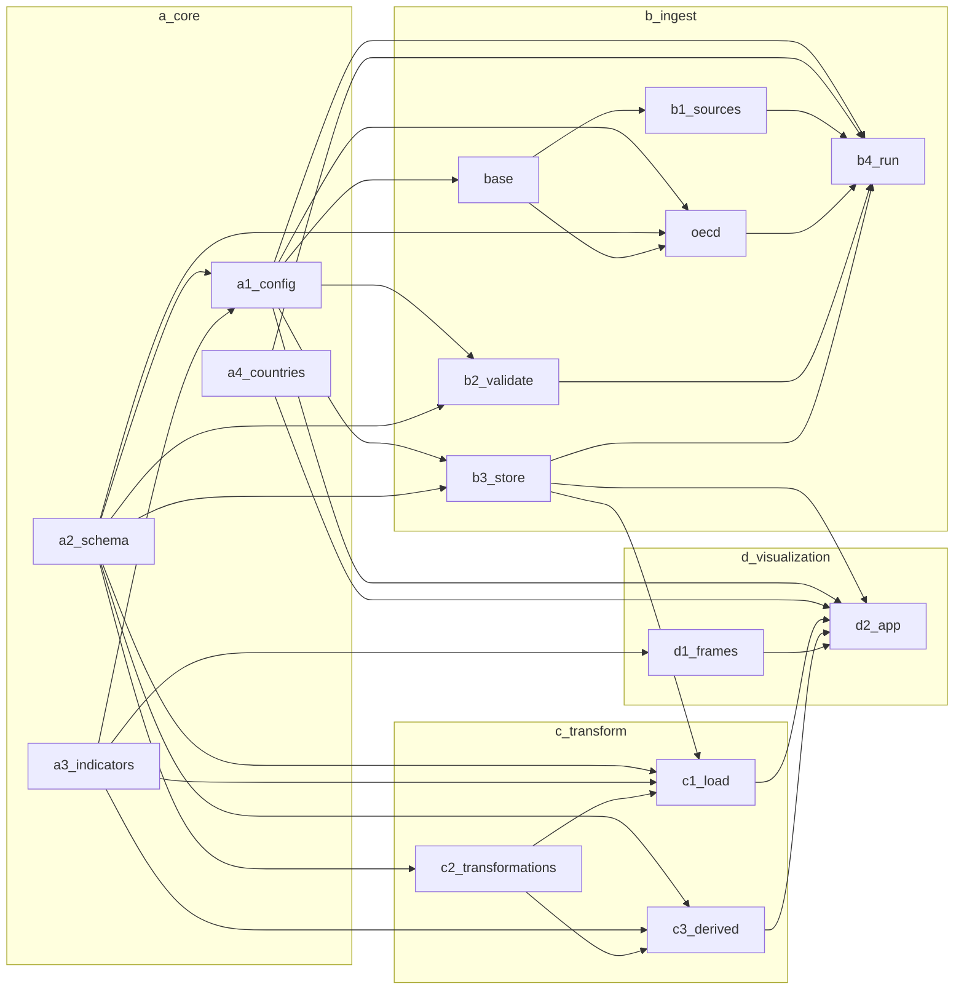

| Module | What it does |
|---|---|
| [`a_core.a1_config`](#mod-a_core-a1_config) | Load the CSV config files: each source's series and the app table. |
| [`a_core.a2_schema`](#mod-a_core-a2_schema) | The canonical long-format table every source produces, plus period helpers. |
| [`a_core.a3_indicators`](#mod-a_core-a3_indicators) | The indicator registry: every conceptual indicator, with a display label and a description. |
| [`a_core.a4_countries`](#mod-a_core-a4_countries) | The country registry: every country MacroScan knows, keyed by ISO3 code, with a display label. |
| [`b_ingest.b1_sources`](#mod-b_ingest-b1_sources) | Data sources. Importing this package registers every source in SOURCES. |
| [`b_ingest.b1_sources.base`](#mod-b_ingest-b1_sources-base) | The interface every data source implements. |
| [`b_ingest.b1_sources.oecd`](#mod-b_ingest-b1_sources-oecd) | OECD SDMX REST API (https://sdmx.oecd.org/public/rest). |
| [`b_ingest.b2_validate`](#mod-b_ingest-b2_validate) | Check a source's fetch() output matches the canonical schema before storing it. |
| [`b_ingest.b3_store`](#mod-b_ingest-b3_store) | Append-only change log of observations, one Parquet file per (source, indicator, frequency). |
| [`b_ingest.b4_run`](#mod-b_ingest-b4_run) | Command line entry point: `macroscan ingest` and `macroscan describe`. |
| [`c_transform.c1_load`](#mod-c_transform-c1_load) | Pull the ingested data into the transform stage. |
| [`c_transform.c2_transformations`](#mod-c_transform-c2_transformations) | Building blocks for derived indicators: pure functions over canonical long frames. |
| [`c_transform.c3_derived`](#mod-c_transform-c3_derived) | Derived indicators, defined in code: one recipe per derived Indicator. |
| [`d_visualization.d1_frames`](#mod-d_visualization-d1_frames) | Shape the ingested data for the app: a latest-value table and chartable series. |
| [`d_visualization.d2_app`](#mod-d_visualization-d2_app) | Streamlit app: latest values by indicator and country; click cells to chart them. |

| Class | What it does |
|---|---|
| [`ConfigError`](#cls-ConfigError) | Raised when a config CSV is missing, malformed or inconsistent. |
| [`SeriesSpec`](#cls-SeriesSpec) | One source's series for an (indicator, frequency): where to fetch it and how to filter it. |
| [`PeriodInterval`](#cls-PeriodInterval) | A span of time, e.g. PeriodInterval.months(12); `periods_at` counts it at one of our frequencies. |
| [`Indicator`](#cls-Indicator) | A conceptual indicator; the value is the member name, as used in config and stored data. |
| [`Country`](#cls-Country) | A country; the value is its ISO3 code (the member name), as used in config and stored data. |
| [`Source`](#cls-Source) | A data provider. fetch() returns a frame with a2_schema.FETCH_COLUMNS. |
| [`OECDError`](#cls-OECDError) | Raised for OECD API failures and unexpected responses. |
| [`Dataflow`](#cls-Dataflow) | Reference to an OECD dataflow: agency, dataflow id and version. |
| [`Dimension`](#cls-Dimension) | One dimension of a dataflow's key, with its codelist. |
| [`Structure`](#cls-Structure) | The parts of a dataflow's structure needed to build keys and describe it. |
| [`OECDClient`](#cls-OECDClient) | requests wrapper with backoff on 429/5xx and a minimum gap between calls. |
| [`OECDSource`](#cls-OECDSource) | Source for OECD series configured as named dimension filters plus a frequency. |
| [`SchemaError`](#cls-SchemaError) | Raised when a fetched frame doesn't match the canonical schema. |
| [`ChangeSummary`](#cls-ChangeSummary) | What one ingest of a series changed. |
| [`Store`](#cls-Store) | Reads and writes the per-series change logs and the manifest. |
| [`Derivation`](#cls-Derivation) | How `indicator` is computed: `func` called with one long frame per input, by lower-cased name. |

## Classes

```mermaid
classDiagram
  class ConfigError {
  }
  ValueError <|-- ConfigError
  class SeriesSpec {
    source: str
    indicator: Indicator
    frequency: str
    dataflow: str
    filters: dict~str, tuple~str, ...~~
    start: str or None
    end: str or None
    name: str
    label(self) : str
  }
  class PeriodInterval {
    total_months: int
    __post_init__(self) : None
    months(cls, n: int) : PeriodInterval
    quarters(cls, n: int) : PeriodInterval
    years(cls, n: int) : PeriodInterval
    periods_at(self, frequency: str) : int or None
  }
  class Indicator {
    label: str
    description: str
    _generate_next_value_(name: str, start: int, count: int, last_values: list) : str
    __new__(cls, value: str, label: str, description: str) : Indicator
    __repr__(self) : str
    parse(cls, text: str) : Indicator
  }
  StrEnum <|-- Indicator
  class Country {
    label: str
    _generate_next_value_(name: str, start: int, count: int, last_values: list) : str
    __new__(cls, value: str, label: str) : Country
    __repr__(self) : str
    parse(cls, text: str) : Country
  }
  StrEnum <|-- Country
  class Source {
    name: str
    fetch(self, spec: SeriesSpec, countries: list~str~) : pd.DataFrame
  }
  class OECDError {
  }
  RuntimeError <|-- OECDError
  class Dataflow {
    agency: str
    id: str
    version: str
    parse(cls, text: str) : Dataflow
    label(self) : str
  }
  class Dimension {
    id: str
    position: int
    name: str
    codes: dict~str, str~
    available: list~str~ or None
  }
  class Structure {
    dataflow: str
    name: str
    dimensions: list~Dimension~
    dimension(self, dim_id: str) : Dimension
    to_json(self) : str
    from_json(cls, text: str) : Structure
  }
  class OECDClient {
    get(self, path: str, accept: str, params: dict or None=None) : requests.Response
  }
  class OECDSource {
    structure(self, dataflow: str or Dataflow) : Structure
    fetch(self, spec: SeriesSpec, countries: list~str~) : pd.DataFrame
  }
  Source <|-- OECDSource
  class SchemaError {
  }
  ValueError <|-- SchemaError
  class ChangeSummary {
    new: int
    revised: int
    withdrawn: int
    rows_in_pull: int
    countries_missing: list~str~
    appended(self) : int
  }
  class Store {
    path(self, source: str, indicator: str, frequency: str) : Path
    _find(self, indicator: str, frequency: str, source: str or None) : Path
    load_log(self, source: str, indicator: str, frequency: str) : pd.DataFrame
    apply(self, pulled: pd.DataFrame, source: str, indicator: str, frequency: str, requested_countries: list~str~ or None=None, pulled_at: datetime or None=None) : ChangeSummary
    record_request(self, source: str, indicator: str, frequency: str, url: str or None) : None
    read_history(self, indicator: str, frequency: str, source: str or None=None, country: str or None=None, period: str or None=None) : pd.DataFrame
    read_as_of(self, indicator: str, frequency: str, when, source: str or None=None) : pd.DataFrame
    read_latest(self, indicator: str, frequency: str, source: str or None=None) : pd.DataFrame
    read_all_latest(self, frequency: str, source: str or None=None) : pd.DataFrame
    manifest_path(self) : Path
    manifest(self) : dict
    _write_manifest(self, manifest: dict) : None
    _update_manifest(self, key: str, summary: ChangeSummary, pulled_at, path: Path) : None
  }
  class Derivation {
    indicator: Indicator
    inputs: tuple~Indicator, ...~
    func: Callable~..., pd.DataFrame~
    unit: str or None
  }
  click ConfigError href "#cls-ConfigError"
  click SeriesSpec href "#cls-SeriesSpec"
  click PeriodInterval href "#cls-PeriodInterval"
  click Indicator href "#cls-Indicator"
  click Country href "#cls-Country"
  click Source href "#cls-Source"
  click OECDError href "#cls-OECDError"
  click Dataflow href "#cls-Dataflow"
  click Dimension href "#cls-Dimension"
  click Structure href "#cls-Structure"
  click OECDClient href "#cls-OECDClient"
  click OECDSource href "#cls-OECDSource"
  click SchemaError href "#cls-SchemaError"
  click ChangeSummary href "#cls-ChangeSummary"
  click Store href "#cls-Store"
  click Derivation href "#cls-Derivation"
```

## Reference

### [`a_core.a1_config`](../src/macroscan/a_core/a1_config.py)

Load the CSV config files: each source's series and the app table.

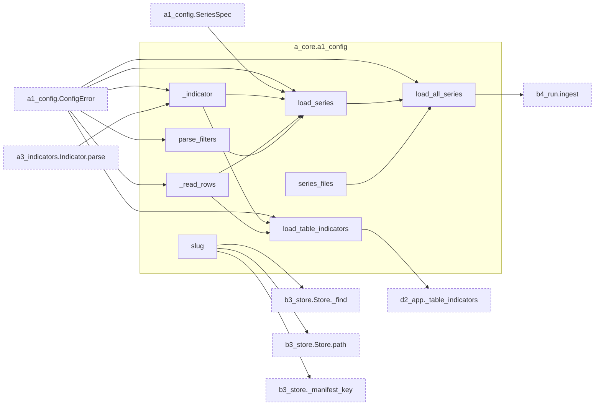

- **[`slug(indicator: str) -> str`](../src/macroscan/a_core/a1_config.py#L58)** — Filesystem-safe form of an indicator name: 'REAL_GDP' -> 'real_gdp'. Not an identifier.
  - returns: `re.sub('[^a-z0-9]+', '_', indicator.l...`: `str`
  - calls: *(none)*
  - called by: [`b3_store.Store._find`](#fn-b_ingest-b3_store-Store._find), [`b3_store.Store.path`](#fn-b_ingest-b3_store-Store.path), [`b3_store._manifest_key`](#fn-b_ingest-b3_store-_manifest_key)
- **[`parse_filters(text: str) -> dict[str, tuple[str, ...]]`](../src/macroscan/a_core/a1_config.py#L63)** — Parse 'FREQ=Q;SEX=M+F' into {'FREQ': ('Q',), 'SEX': ('M', 'F')}.
  - returns: `filters`: `dict[str, tuple[str, ...]]`
  - calls: [`ConfigError`](#cls-ConfigError)
  - called by: [`load_series`](#fn-a_core-a1_config-load_series)
- **[`_read_rows(path: Path, required: set[str]) -> list[dict[str, str]]`](../src/macroscan/a_core/a1_config.py#L83)** — Read a CSV into stripped dicts, skipping blank and '#'-commented rows.
  - returns: `[r for r in rows if any(r.values()) a...`: `list[dict[str, str]]`
  - calls: [`ConfigError`](#cls-ConfigError)
  - called by: [`load_series`](#fn-a_core-a1_config-load_series), [`load_table_indicators`](#fn-a_core-a1_config-load_table_indicators)
- **[`_indicator(text: str, where: str) -> Indicator`](../src/macroscan/a_core/a1_config.py#L97)** — The Indicator named `text`, or a ConfigError pointing at `where`.
  - returns: `Indicator.parse(text)`: `Indicator`
  - calls: [`ConfigError`](#cls-ConfigError), [`a3_indicators.Indicator.parse`](#fn-a_core-a3_indicators-Indicator.parse)
  - called by: [`load_series`](#fn-a_core-a1_config-load_series), [`load_table_indicators`](#fn-a_core-a1_config-load_table_indicators)
- **[`load_table_indicators(path: Path) -> list[Indicator]`](../src/macroscan/a_core/a1_config.py#L105)** — Load the indicators the app's table shows, in file order; each must be a defined Indicator.
  - returns: `shown`: `list[Indicator]`
  - calls: [`ConfigError`](#cls-ConfigError), [`_indicator`](#fn-a_core-a1_config-_indicator), [`_read_rows`](#fn-a_core-a1_config-_read_rows)
  - called by: [`d2_app._table_indicators`](#fn-d_visualization-d2_app-_table_indicators)
- **[`load_series(path: Path, source: str) -> list[SeriesSpec]`](../src/macroscan/a_core/a1_config.py#L118)** — Load and validate one source's series CSV into SeriesSpecs.
  - returns: `specs`: `list[SeriesSpec]`
  - calls: [`ConfigError`](#cls-ConfigError), [`SeriesSpec`](#cls-SeriesSpec), [`_indicator`](#fn-a_core-a1_config-_indicator), [`_read_rows`](#fn-a_core-a1_config-_read_rows), [`parse_filters`](#fn-a_core-a1_config-parse_filters)
  - called by: [`load_all_series`](#fn-a_core-a1_config-load_all_series)
- **[`series_files(config_dir: Path) -> dict[str, Path]`](../src/macroscan/a_core/a1_config.py#L153)** — Map source name -> its series CSV, e.g. {'oecd': config/02_oecd_indicators.csv}.
  - returns: `files`: `dict[str, Path]`
  - calls: *(none)*
  - called by: [`load_all_series`](#fn-a_core-a1_config-load_all_series)
- **[`load_all_series(config_dir: Path=DEFAULT_CONFIG_DIR) -> list[SeriesSpec]`](../src/macroscan/a_core/a1_config.py#L163)** — Load every source's series CSV; each (source, indicator, frequency) may appear once.
  - returns: `specs`: `list[SeriesSpec]`
  - calls: [`ConfigError`](#cls-ConfigError), [`load_series`](#fn-a_core-a1_config-load_series), [`series_files`](#fn-a_core-a1_config-series_files)
  - called by: [`b4_run.ingest`](#fn-b_ingest-b4_run-ingest)
- **[class `ConfigError`](../src/macroscan/a_core/a1_config.py#L32)** — Raised when a config CSV is missing, malformed or inconsistent.
- **[class `SeriesSpec`](../src/macroscan/a_core/a1_config.py#L37)** — One source's series for an (indicator, frequency): where to fetch it and how to filter it.
  - **[`label(self) -> str`](../src/macroscan/a_core/a1_config.py#L53)** — 'oecd/REAL_GDP/Q', for logs and error messages.
    - returns: `f'{self.source}/{self.indicator}/{sel...`: `str`
    - calls: *(none)*

### [`a_core.a2_schema`](../src/macroscan/a_core/a2_schema.py)

The canonical long-format table every source produces, plus period helpers.

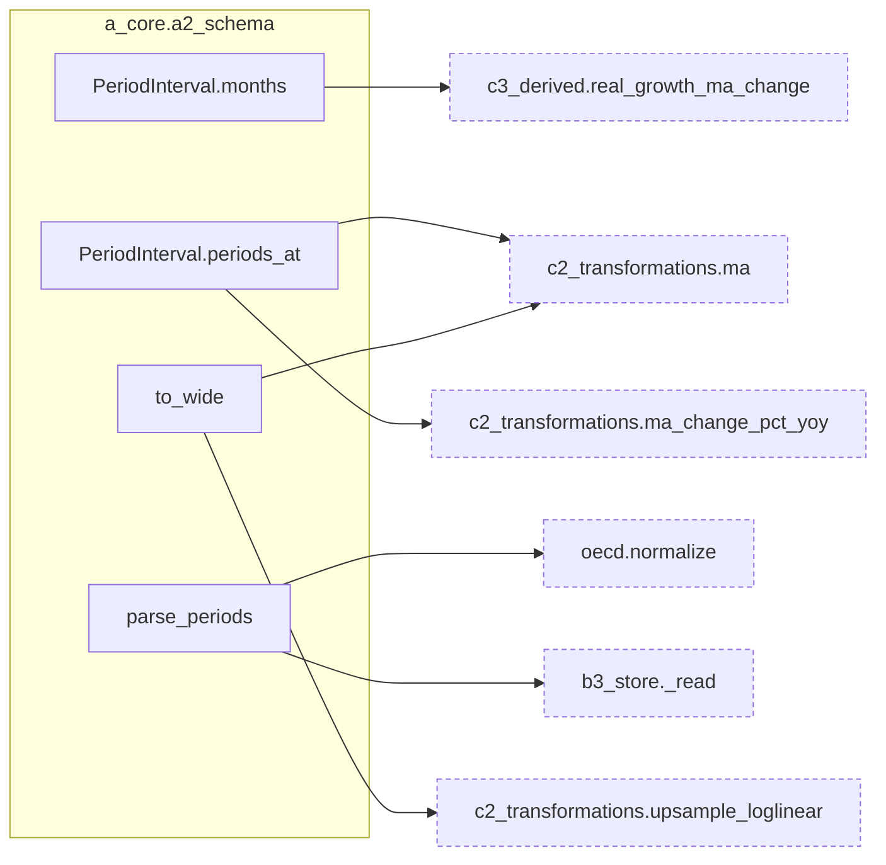

- **[`parse_periods(values: pd.Series | list[str], frequency: str) -> pd.Series`](../src/macroscan/a_core/a2_schema.py#L67)** — Parse period strings ('2024', '2024-Q1', '2024Q1', '2024-03') into a Period Series.
  - returns: `pd.Series(pd.PeriodIndex(text, freq=P...`: `pd.Series`
  - calls: *(none)*
  - called by: [`oecd.normalize`](#fn-b_ingest-b1_sources-oecd-normalize), [`b3_store._read`](#fn-b_ingest-b3_store-_read)
- **[`to_wide(df: pd.DataFrame, columns: str='country') -> pd.DataFrame`](../src/macroscan/a_core/a2_schema.py#L75)** — Pivot a long frame for one indicator at one frequency into a PeriodIndex x country matrix.
  - returns: `wide.sort_index()`: `pd.DataFrame`
  - calls: *(none)*
  - called by: [`c2_transformations.ma`](#fn-c_transform-c2_transformations-ma), [`c2_transformations.upsample_loglinear`](#fn-c_transform-c2_transformations-upsample_loglinear)
- **[class `PeriodInterval`](../src/macroscan/a_core/a2_schema.py#L39)** — A span of time, e.g. PeriodInterval.months(12); `periods_at` counts it at one of our frequencies.
  - **[`__post_init__(self) -> None`](../src/macroscan/a_core/a2_schema.py#L44)** — *(no docstring)*
    - returns: *(none)*
    - calls: *(none)*
  - **[`months(cls, n: int) -> PeriodInterval`](../src/macroscan/a_core/a2_schema.py#L49)** — *(no docstring)*
    - returns: `cls(n)`: `PeriodInterval`
    - calls: *(none)*
    - called by: [`c3_derived.real_growth_ma_change`](#fn-c_transform-c3_derived-real_growth_ma_change)
  - **[`quarters(cls, n: int) -> PeriodInterval`](../src/macroscan/a_core/a2_schema.py#L53)** — *(no docstring)*
    - returns: `cls(3 * n)`: `PeriodInterval`
    - calls: *(none)*
  - **[`years(cls, n: int) -> PeriodInterval`](../src/macroscan/a_core/a2_schema.py#L57)** — *(no docstring)*
    - returns: `cls(12 * n)`: `PeriodInterval`
    - calls: *(none)*
  - **[`periods_at(self, frequency: str) -> int | None`](../src/macroscan/a_core/a2_schema.py#L60)** — How many `frequency` periods span this interval; None if it isn't a whole number of them.
    - returns: `whole if rest == 0 else None`: `int | None`
    - calls: *(none)*
    - called by: [`c2_transformations.ma`](#fn-c_transform-c2_transformations-ma), [`c2_transformations.ma_change_pct_yoy`](#fn-c_transform-c2_transformations-ma_change_pct_yoy)

### [`a_core.a3_indicators`](../src/macroscan/a_core/a3_indicators.py)

The indicator registry: every conceptual indicator, with a display label and a description.

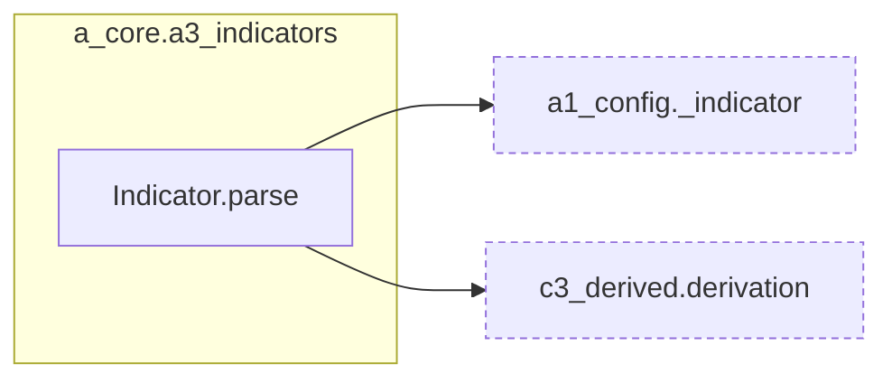

- **[class `Indicator`](../src/macroscan/a_core/a3_indicators.py#L12)** — A conceptual indicator; the value is the member name, as used in config and stored data.
  - **[`_generate_next_value_(name: str, start: int, count: int, last_values: list) -> str`](../src/macroscan/a_core/a3_indicators.py#L19)** — auto() gives the member name, so REAL_GDP's value is 'REAL_GDP'.
    - returns: `name`: `str`
    - calls: *(none)*
  - **[`__new__(cls, value: str, label: str, description: str) -> Indicator`](../src/macroscan/a_core/a3_indicators.py#L23)** — *(no docstring)*
    - returns: `member`: `Indicator`
    - calls: *(none)*
  - **[`__repr__(self) -> str`](../src/macroscan/a_core/a3_indicators.py#L30)** — 'REAL_GDP' (quoted), so `{indicator!r}` in messages reads like a plain string.
    - returns: `repr(self.value)`: `str`
    - calls: *(none)*
  - **[`parse(cls, text: str) -> Indicator`](../src/macroscan/a_core/a3_indicators.py#L35)** — Look up an indicator by its exact member name, e.g. 'REAL_GDP'.
    - returns: `cls(text)`: `Indicator`
    - calls: *(none)*
    - called by: [`a1_config._indicator`](#fn-a_core-a1_config-_indicator), [`c3_derived.derivation`](#fn-c_transform-c3_derived-derivation)

### [`a_core.a4_countries`](../src/macroscan/a_core/a4_countries.py)

The country registry: every country MacroScan knows, keyed by ISO3 code, with a display label.

- **[class `Country`](../src/macroscan/a_core/a4_countries.py#L12)** — A country; the value is its ISO3 code (the member name), as used in config and stored data.
  - **[`_generate_next_value_(name: str, start: int, count: int, last_values: list) -> str`](../src/macroscan/a_core/a4_countries.py#L18)** — auto() gives the member name, so USA's value is 'USA'.
    - returns: `name`: `str`
    - calls: *(none)*
  - **[`__new__(cls, value: str, label: str) -> Country`](../src/macroscan/a_core/a4_countries.py#L22)** — *(no docstring)*
    - returns: `member`: `Country`
    - calls: *(none)*
  - **[`__repr__(self) -> str`](../src/macroscan/a_core/a4_countries.py#L28)** — 'USA' (quoted), so `{country!r}` in messages reads like a plain string.
    - returns: `repr(self.value)`: `str`
    - calls: *(none)*
  - **[`parse(cls, text: str) -> Country`](../src/macroscan/a_core/a4_countries.py#L33)** — Look up a country by its exact ISO3 code, e.g. 'USA'.
    - returns: `cls(text)`: `Country`
    - calls: *(none)*

### [`b_ingest.b1_sources`](../src/macroscan/b_ingest/b1_sources/__init__.py)

Data sources. Importing this package registers every source in SOURCES.

### [`b_ingest.b1_sources.base`](../src/macroscan/b_ingest/b1_sources/base.py)

The interface every data source implements.

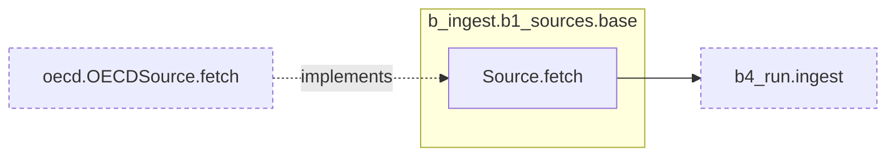

- **[`register(cls: type[Source]) -> type[Source]`](../src/macroscan/b_ingest/b1_sources/base.py#L32)** — Class decorator that adds a Source to SOURCES under its `name`.
  - returns: `cls`: `type[Source]`
  - calls: *(none)*
- **[class `Source`](../src/macroscan/b_ingest/b1_sources/base.py#L13)** — A data provider. fetch() returns a frame with a2_schema.FETCH_COLUMNS.
  - **[`__init__(self, cache_dir: Path, refresh_structures: bool=False)`](../src/macroscan/b_ingest/b1_sources/base.py#L18)** — Set up the source with a directory for cached metadata.
    - returns: *(none)*
    - calls: *(none)*
  - **[`fetch(self, spec: SeriesSpec, countries: list[str]) -> pd.DataFrame`](../src/macroscan/b_ingest/b1_sources/base.py#L25)** — Fetch one series (indicator at a frequency) for the given countries as a canonical frame.
    - returns: `pd.DataFrame`
    - calls: *(none)*
    - called by: [`b4_run.ingest`](#fn-b_ingest-b4_run-ingest)
    - implemented by: [`oecd.OECDSource.fetch`](#fn-b_ingest-b1_sources-oecd-OECDSource.fetch)

### [`b_ingest.b1_sources.oecd`](../src/macroscan/b_ingest/b1_sources/oecd.py)

OECD SDMX REST API (https://sdmx.oecd.org/public/rest).

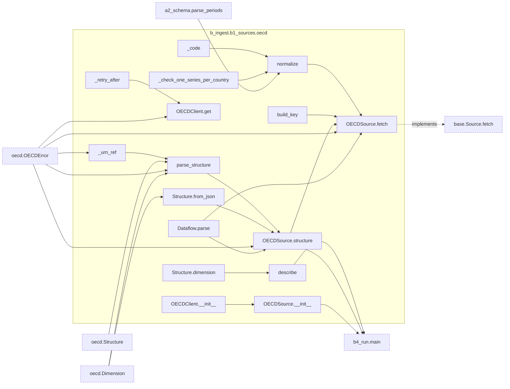

- **[`_urn_ref(urn: str) -> tuple[str, str, str, str | None]`](../src/macroscan/b_ingest/b1_sources/oecd.py#L106)** — '...Codelist=OECD:CL_AREA(1.5)' -> ('OECD', 'CL_AREA', '1.5', None).
  - returns: `(m.group(1), m.group(2), m.group(3), ...`: `tuple[str, str, str, str | None]`
  - calls: [`OECDError`](#cls-OECDError)
  - called by: [`parse_structure`](#fn-b_ingest-b1_sources-oecd-parse_structure)
- **[`parse_structure(payload: dict, dataflow: Dataflow) -> Structure`](../src/macroscan/b_ingest/b1_sources/oecd.py#L114)** — Reduce an SDMX-JSON structure message to dimensions + codelists.
  - returns: `Structure(dataflow.label, flow.get('n...`: `Structure`
  - calls: [`Dimension`](#cls-Dimension), [`OECDError`](#cls-OECDError), [`Structure`](#cls-Structure), [`_urn_ref`](#fn-b_ingest-b1_sources-oecd-_urn_ref)
  - called by: [`OECDSource.structure`](#fn-b_ingest-b1_sources-oecd-OECDSource.structure)
- **[`build_key(structure: Structure, filters: dict[str, tuple[str, ...]], countries: list[str]) -> str`](../src/macroscan/b_ingest/b1_sources/oecd.py#L151)** — Place named filters into the positional SDMX key; unlisted dims are wildcards.
  - returns: `'.'.join(parts)`: `str`
  - calls: *(none)*
  - called by: [`OECDSource.fetch`](#fn-b_ingest-b1_sources-oecd-OECDSource.fetch)
- **[`_retry_after(resp: requests.Response) -> float | None`](../src/macroscan/b_ingest/b1_sources/oecd.py#L231)** — Seconds from a Retry-After header, or None if absent or not a number.
  - returns: `float(resp.headers.get('Retry-After',...`: `float | None`
  - calls: *(none)*
  - called by: [`OECDClient.get`](#fn-b_ingest-b1_sources-oecd-OECDClient.get)
- **[`_code(value: str) -> str`](../src/macroscan/b_ingest/b1_sources/oecd.py#L301)** — 'USA: United States' -> 'USA' (labels=both CSV).
  - returns: `value.split(': ', 1)[0] if isinstance...`: `str`
  - calls: *(none)*
  - called by: [`normalize`](#fn-b_ingest-b1_sources-oecd-normalize)
- **[`normalize(csv_text: str, spec: SeriesSpec, structure: Structure) -> pd.DataFrame`](../src/macroscan/b_ingest/b1_sources/oecd.py#L306)** — Turn OECD SDMX-CSV (labels=both) into the canonical fetch frame.
  - returns: `pd.DataFrame({c: pd.Series(dtype='obj...`, `out.sort_values(['country', 'period']...`: `pd.DataFrame`
  - calls: [`a2_schema.parse_periods`](#fn-a_core-a2_schema-parse_periods), [`_check_one_series_per_country`](#fn-b_ingest-b1_sources-oecd-_check_one_series_per_country), [`_code`](#fn-b_ingest-b1_sources-oecd-_code)
  - called by: [`OECDSource.fetch`](#fn-b_ingest-b1_sources-oecd-OECDSource.fetch)
- **[`_unit_mult_label(code: str) -> str`](../src/macroscan/b_ingest/b1_sources/oecd.py#L345)** — Label for UNIT_MULT codes, e.g. '6' -> 'millions'.
  - returns: `names.get(code, f'x1e{code}')`: `str`
  - calls: *(none)*
- **[`_check_one_series_per_country(raw: pd.DataFrame, spec: SeriesSpec, dim_ids: list[str]) -> None`](../src/macroscan/b_ingest/b1_sources/oecd.py#L351)** — Filters must narrow the dataflow to a single series per country.
  - returns: *(none)*
  - calls: *(none)*
  - called by: [`normalize`](#fn-b_ingest-b1_sources-oecd-normalize)
- **[`describe(structure: Structure, dim: str | None=None, limit: int=25) -> str`](../src/macroscan/b_ingest/b1_sources/oecd.py#L364)** — Human-readable listing of a dataflow's dimensions and their codes.
  - returns: `'\n'.join(lines)`: `str`
  - calls: [`Structure.dimension`](#fn-b_ingest-b1_sources-oecd-Structure.dimension)
  - called by: [`b4_run.main`](#fn-b_ingest-b4_run-main)
- **[class `OECDError`](../src/macroscan/b_ingest/b1_sources/oecd.py#L36)** — Raised for OECD API failures and unexpected responses.
- **[class `Dataflow`](../src/macroscan/b_ingest/b1_sources/oecd.py#L44)** — Reference to an OECD dataflow: agency, dataflow id and version.
  - **[`parse(cls, text: str) -> Dataflow`](../src/macroscan/b_ingest/b1_sources/oecd.py#L51)** — 'OECD.SDD.NAD:DSD_NAMAIN1@DF_QNA[@1.1]' -> Dataflow.
    - returns: `cls(agency, f'{parts[0]}@{parts[1]}',...`, `cls(agency, rest)`: `Dataflow`
    - calls: *(none)*
    - called by: [`OECDSource.fetch`](#fn-b_ingest-b1_sources-oecd-OECDSource.fetch), [`OECDSource.structure`](#fn-b_ingest-b1_sources-oecd-OECDSource.structure)
  - **[`label(self) -> str`](../src/macroscan/b_ingest/b1_sources/oecd.py#L63)** — 'AGENCY:DATAFLOW_ID', the form used in config and cache keys.
    - returns: `f'{self.agency}:{self.id}'`: `str`
    - calls: *(none)*
- **[class `Dimension`](../src/macroscan/b_ingest/b1_sources/oecd.py#L69)** — One dimension of a dataflow's key, with its codelist.
- **[class `Structure`](../src/macroscan/b_ingest/b1_sources/oecd.py#L79)** — The parts of a dataflow's structure needed to build keys and describe it.
  - **[`dimension(self, dim_id: str) -> Dimension`](../src/macroscan/b_ingest/b1_sources/oecd.py#L85)** — Look up a dimension by id; raises KeyError if absent.
    - returns: `d`: `Dimension`
    - calls: *(none)*
    - called by: [`describe`](#fn-b_ingest-b1_sources-oecd-describe)
  - **[`to_json(self) -> str`](../src/macroscan/b_ingest/b1_sources/oecd.py#L92)** — Serialize for the on-disk structure cache.
    - returns: `json.dumps(asdict(self), indent=1)`: `str`
    - calls: *(none)*
  - **[`from_json(cls, text: str) -> Structure`](../src/macroscan/b_ingest/b1_sources/oecd.py#L97)** — Load a structure previously written by to_json().
    - returns: `cls(raw['dataflow'], raw['name'], [Di...`: `Structure`
    - calls: [`Dimension`](#cls-Dimension)
    - called by: [`OECDSource.structure`](#fn-b_ingest-b1_sources-oecd-OECDSource.structure)
- **[class `OECDClient`](../src/macroscan/b_ingest/b1_sources/oecd.py#L180)** — requests wrapper with backoff on 429/5xx and a minimum gap between calls.
  - **[`__init__(self, base_url: str=BASE_URL, timeout: float=90, retries: int=4, backoff: float=5, min_interval: float=1.5, session: requests.Session | None=None)`](../src/macroscan/b_ingest/b1_sources/oecd.py#L183)** — Configure base URL, timeout, retry count, backoff (seconds) and minimum gap between calls.
    - returns: *(none)*
    - calls: *(none)*
    - called by: [`OECDSource.__init__`](#fn-b_ingest-b1_sources-oecd-OECDSource.__init__)
  - **[`get(self, path: str, accept: str, params: dict | None=None) -> requests.Response`](../src/macroscan/b_ingest/b1_sources/oecd.py#L202)** — GET a path, sleeping between calls and retrying 429/5xx and network errors.
    - returns: `resp`: `requests.Response`
    - calls: [`OECDError`](#cls-OECDError), [`_retry_after`](#fn-b_ingest-b1_sources-oecd-_retry_after)
- **[class `OECDSource`](../src/macroscan/b_ingest/b1_sources/oecd.py#L243)** — Source for OECD series configured as named dimension filters plus a frequency.
  - **[`__init__(self, cache_dir: Path, refresh_structures: bool=False, client: OECDClient | None=None)`](../src/macroscan/b_ingest/b1_sources/oecd.py#L247)** — Create the source; `client` can be injected for tests.
    - returns: *(none)*
    - calls: [`OECDClient.__init__`](#fn-b_ingest-b1_sources-oecd-OECDClient.__init__)
    - called by: [`b4_run.main`](#fn-b_ingest-b4_run-main)
  - **[`structure(self, dataflow: str | Dataflow) -> Structure`](../src/macroscan/b_ingest/b1_sources/oecd.py#L253)** — Return a dataflow's structure, from memory, the disk cache, or the API.
    - returns: `self._structures[flow.label]`, `structure`: `Structure`
    - calls: [`Dataflow.parse`](#fn-b_ingest-b1_sources-oecd-Dataflow.parse), [`OECDError`](#cls-OECDError), [`Structure.from_json`](#fn-b_ingest-b1_sources-oecd-Structure.from_json), [`parse_structure`](#fn-b_ingest-b1_sources-oecd-parse_structure)
    - called by: [`OECDSource.fetch`](#fn-b_ingest-b1_sources-oecd-OECDSource.fetch), [`b4_run.main`](#fn-b_ingest-b4_run-main)
  - **[`fetch(self, spec: SeriesSpec, countries: list[str]) -> pd.DataFrame`](../src/macroscan/b_ingest/b1_sources/oecd.py#L276)** — Fetch one series for the given countries as a canonical frame.
    - returns: `normalize('', spec, structure)`, `normalize(resp.text, spec, structure)`: `pd.DataFrame`
    - calls: [`Dataflow.parse`](#fn-b_ingest-b1_sources-oecd-Dataflow.parse), [`OECDError`](#cls-OECDError), [`OECDSource.structure`](#fn-b_ingest-b1_sources-oecd-OECDSource.structure), [`build_key`](#fn-b_ingest-b1_sources-oecd-build_key), [`normalize`](#fn-b_ingest-b1_sources-oecd-normalize)
    - overrides: [`base.Source.fetch`](#fn-b_ingest-b1_sources-base-Source.fetch)

### [`b_ingest.b2_validate`](../src/macroscan/b_ingest/b2_validate.py)

Check a source's fetch() output matches the canonical schema before storing it.

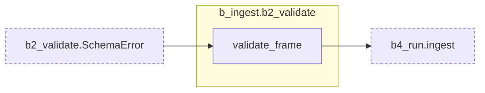

- **[`validate_frame(df: pd.DataFrame, spec: SeriesSpec) -> pd.DataFrame`](../src/macroscan/b_ingest/b2_validate.py#L15)** — Check a fetched frame against the canonical schema; return it with columns in order.
  - returns: `df`: `pd.DataFrame`
  - calls: [`SchemaError`](#cls-SchemaError)
  - called by: [`b4_run.ingest`](#fn-b_ingest-b4_run-ingest)
- **[class `SchemaError`](../src/macroscan/b_ingest/b2_validate.py#L11)** — Raised when a fetched frame doesn't match the canonical schema.

### [`b_ingest.b3_store`](../src/macroscan/b_ingest/b3_store.py)

Append-only change log of observations, one Parquet file per (source, indicator, frequency).

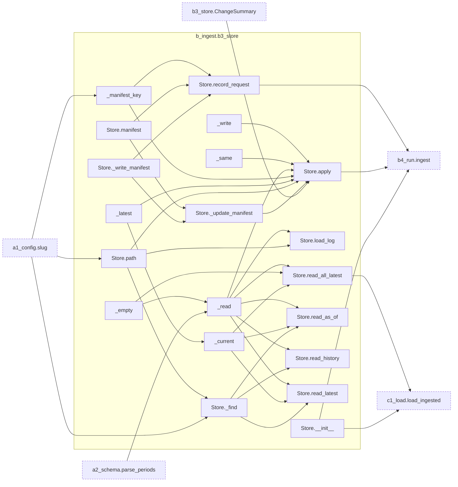

- **[`_manifest_key(source: str, indicator: str, frequency: str) -> str`](../src/macroscan/b_ingest/b3_store.py#L199)** — Manifest entry key for a series, e.g. 'oecd/real_gdp/Q'.
  - returns: `f'{source}/{slug(indicator)}/{frequen...`: `str`
  - calls: [`a1_config.slug`](#fn-a_core-a1_config-slug)
  - called by: [`Store.apply`](#fn-b_ingest-b3_store-Store.apply), [`Store.record_request`](#fn-b_ingest-b3_store-Store.record_request)
- **[`_empty() -> pd.DataFrame`](../src/macroscan/b_ingest/b3_store.py#L204)** — An empty frame with the stored columns.
  - returns: `pd.DataFrame({c: pd.Series(dtype='obj...`: `pd.DataFrame`
  - calls: *(none)*
  - called by: [`Store.read_all_latest`](#fn-b_ingest-b3_store-Store.read_all_latest), [`_read`](#fn-b_ingest-b3_store-_read)
- **[`_write(path: Path, df: pd.DataFrame) -> None`](../src/macroscan/b_ingest/b3_store.py#L209)** — Write a change log atomically, storing periods as strings.
  - returns: *(none)*
  - calls: *(none)*
  - called by: [`Store.apply`](#fn-b_ingest-b3_store-Store.apply)
- **[`_read(path: Path) -> pd.DataFrame`](../src/macroscan/b_ingest/b3_store.py#L218)** — Read a change log, restoring the Period dtype (empty frame if missing).
  - returns: `_empty()`, `df`: `pd.DataFrame`
  - calls: [`a2_schema.parse_periods`](#fn-a_core-a2_schema-parse_periods), [`_empty`](#fn-b_ingest-b3_store-_empty)
  - called by: [`Store.apply`](#fn-b_ingest-b3_store-Store.apply), [`Store.load_log`](#fn-b_ingest-b3_store-Store.load_log), [`Store.read_all_latest`](#fn-b_ingest-b3_store-Store.read_all_latest), [`Store.read_as_of`](#fn-b_ingest-b3_store-Store.read_as_of), [`Store.read_history`](#fn-b_ingest-b3_store-Store.read_history), [`Store.read_latest`](#fn-b_ingest-b3_store-Store.read_latest)
- **[`_current(log_df: pd.DataFrame) -> pd.DataFrame`](../src/macroscan/b_ingest/b3_store.py#L230)** — Latest value per (country, period) with withdrawn observations dropped.
  - returns: `latest[latest['value'].notna()].reset...`: `pd.DataFrame`
  - calls: [`_latest`](#fn-b_ingest-b3_store-_latest)
  - called by: [`Store.read_all_latest`](#fn-b_ingest-b3_store-Store.read_all_latest), [`Store.read_as_of`](#fn-b_ingest-b3_store-Store.read_as_of), [`Store.read_latest`](#fn-b_ingest-b3_store-Store.read_latest)
- **[`_latest(log_df: pd.DataFrame) -> pd.DataFrame`](../src/macroscan/b_ingest/b3_store.py#L236)** — Most recent stored row per (country, period).
  - returns: `log_df`, `ordered.groupby(KEY, sort=True, obser...`: `pd.DataFrame`
  - calls: *(none)*
  - called by: [`Store.apply`](#fn-b_ingest-b3_store-Store.apply), [`_current`](#fn-b_ingest-b3_store-_current)
- **[`_same(a: pd.Series, b: pd.Series) -> pd.Series`](../src/macroscan/b_ingest/b3_store.py#L244)** — Elementwise equality treating null==null and near-equal floats as the same.
  - returns: `both_null | close`, `both_null | (a.astype(object) == b.as...`: `pd.Series`
  - calls: *(none)*
  - called by: [`Store.apply`](#fn-b_ingest-b3_store-Store.apply)
- **[class `ChangeSummary`](../src/macroscan/b_ingest/b3_store.py#L28)** — What one ingest of a series changed.
  - **[`appended(self) -> int`](../src/macroscan/b_ingest/b3_store.py#L37)** — Total rows appended to the log.
    - returns: `self.new + self.revised + self.withdrawn`: `int`
    - calls: *(none)*
- **[class `Store`](../src/macroscan/b_ingest/b3_store.py#L42)** — Reads and writes the per-series change logs and the manifest.
  - **[`__init__(self, root: Path=DEFAULT_ROOT)`](../src/macroscan/b_ingest/b3_store.py#L44)** — Use `root` (default data/b_ingest) as the storage directory.
    - returns: *(none)*
    - calls: *(none)*
    - called by: [`b4_run.ingest`](#fn-b_ingest-b4_run-ingest), [`c1_load.load_ingested`](#fn-c_transform-c1_load-load_ingested)
  - **[`path(self, source: str, indicator: str, frequency: str) -> Path`](../src/macroscan/b_ingest/b3_store.py#L50)** — Parquet path for one series' change log, e.g. oecd/real_gdp_Q.parquet.
    - returns: `self.root / source / f'{slug(indicato...`: `Path`
    - calls: [`a1_config.slug`](#fn-a_core-a1_config-slug)
    - called by: [`Store._find`](#fn-b_ingest-b3_store-Store._find), [`Store.apply`](#fn-b_ingest-b3_store-Store.apply), [`Store.load_log`](#fn-b_ingest-b3_store-Store.load_log)
  - **[`_find(self, indicator: str, frequency: str, source: str | None) -> Path`](../src/macroscan/b_ingest/b3_store.py#L54)** — Path for an (indicator, frequency), searching all sources when `source` is None.
    - returns: `self.path(source, indicator, frequency)`, `matches[0]`: `Path`
    - calls: [`a1_config.slug`](#fn-a_core-a1_config-slug), [`Store.path`](#fn-b_ingest-b3_store-Store.path)
    - called by: [`Store.read_as_of`](#fn-b_ingest-b3_store-Store.read_as_of), [`Store.read_history`](#fn-b_ingest-b3_store-Store.read_history), [`Store.read_latest`](#fn-b_ingest-b3_store-Store.read_latest)
  - **[`load_log(self, source: str, indicator: str, frequency: str) -> pd.DataFrame`](../src/macroscan/b_ingest/b3_store.py#L66)** — The raw change log for a series (empty frame if none stored).
    - returns: `_read(self.path(source, indicator, fr...`: `pd.DataFrame`
    - calls: [`Store.path`](#fn-b_ingest-b3_store-Store.path), [`_read`](#fn-b_ingest-b3_store-_read)
  - **[`apply(self, pulled: pd.DataFrame, source: str, indicator: str, frequency: str, requested_countries: list[str] | None=None, pulled_at: datetime | None=None) -> ChangeSummary`](../src/macroscan/b_ingest/b3_store.py#L72)** — Diff a full pull against the stored log and append what changed.
    - returns: `summary`: `ChangeSummary`
    - calls: [`ChangeSummary`](#cls-ChangeSummary), [`Store._update_manifest`](#fn-b_ingest-b3_store-Store._update_manifest), [`Store.path`](#fn-b_ingest-b3_store-Store.path), [`_latest`](#fn-b_ingest-b3_store-_latest), [`_manifest_key`](#fn-b_ingest-b3_store-_manifest_key), [`_read`](#fn-b_ingest-b3_store-_read), [`_same`](#fn-b_ingest-b3_store-_same), [`_write`](#fn-b_ingest-b3_store-_write)
    - called by: [`b4_run.ingest`](#fn-b_ingest-b4_run-ingest)
  - **[`record_request(self, source: str, indicator: str, frequency: str, url: str | None) -> None`](../src/macroscan/b_ingest/b3_store.py#L123)** — Remember the request URL used for a series' last pull.
    - returns: *(none)*
    - calls: [`Store._write_manifest`](#fn-b_ingest-b3_store-Store._write_manifest), [`Store.manifest`](#fn-b_ingest-b3_store-Store.manifest), [`_manifest_key`](#fn-b_ingest-b3_store-_manifest_key)
    - called by: [`b4_run.ingest`](#fn-b_ingest-b4_run-ingest)
  - **[`read_history(self, indicator: str, frequency: str, source: str | None=None, country: str | None=None, period: str | None=None) -> pd.DataFrame`](../src/macroscan/b_ingest/b3_store.py#L131)** — Every stored version of every observation (the revision trail).
    - returns: `df.sort_values([*KEY, 'pulled_at']).r...`: `pd.DataFrame`
    - calls: [`Store._find`](#fn-b_ingest-b3_store-Store._find), [`_read`](#fn-b_ingest-b3_store-_read)
  - **[`read_as_of(self, indicator: str, frequency: str, when, source: str | None=None) -> pd.DataFrame`](../src/macroscan/b_ingest/b3_store.py#L147)** — The data as it looked at `when` (tz-naive is treated as UTC).
    - returns: `_current(df[df['pulled_at'] <= when])`: `pd.DataFrame`
    - calls: [`Store._find`](#fn-b_ingest-b3_store-Store._find), [`_current`](#fn-b_ingest-b3_store-_current), [`_read`](#fn-b_ingest-b3_store-_read)
  - **[`read_latest(self, indicator: str, frequency: str, source: str | None=None) -> pd.DataFrame`](../src/macroscan/b_ingest/b3_store.py#L155)** — Today's data: the latest value per (country, period), withdrawn rows dropped.
    - returns: `_current(_read(self._find(indicator, ...`: `pd.DataFrame`
    - calls: [`Store._find`](#fn-b_ingest-b3_store-Store._find), [`_current`](#fn-b_ingest-b3_store-_current), [`_read`](#fn-b_ingest-b3_store-_read)
  - **[`read_all_latest(self, frequency: str, source: str | None=None) -> pd.DataFrame`](../src/macroscan/b_ingest/b3_store.py#L159)** — Latest data for every stored indicator at one frequency, so periods share a dtype.
    - returns: `pd.concat(frames, ignore_index=True) ...`: `pd.DataFrame`
    - calls: [`_current`](#fn-b_ingest-b3_store-_current), [`_empty`](#fn-b_ingest-b3_store-_empty), [`_read`](#fn-b_ingest-b3_store-_read)
    - called by: [`c1_load.load_ingested`](#fn-c_transform-c1_load-load_ingested)
  - **[`manifest_path(self) -> Path`](../src/macroscan/b_ingest/b3_store.py#L169)** — Location of manifest.json.
    - returns: `self.root / 'manifest.json'`: `Path`
    - calls: *(none)*
  - **[`manifest(self) -> dict`](../src/macroscan/b_ingest/b3_store.py#L173)** — The manifest as a dict (empty if not written yet).
    - returns: `{}`, `json.loads(self.manifest_path.read_te...`: `dict`
    - calls: *(none)*
    - called by: [`Store._update_manifest`](#fn-b_ingest-b3_store-Store._update_manifest), [`Store.record_request`](#fn-b_ingest-b3_store-Store.record_request)
  - **[`_write_manifest(self, manifest: dict) -> None`](../src/macroscan/b_ingest/b3_store.py#L179)** — Write the manifest dict to disk.
    - returns: *(none)*
    - calls: *(none)*
    - called by: [`Store._update_manifest`](#fn-b_ingest-b3_store-Store._update_manifest), [`Store.record_request`](#fn-b_ingest-b3_store-Store.record_request)
  - **[`_update_manifest(self, key: str, summary: ChangeSummary, pulled_at, path: Path) -> None`](../src/macroscan/b_ingest/b3_store.py#L184)** — Record pull/change times, the run summary and stored row count.
    - returns: *(none)*
    - calls: [`Store._write_manifest`](#fn-b_ingest-b3_store-Store._write_manifest), [`Store.manifest`](#fn-b_ingest-b3_store-Store.manifest)
    - called by: [`Store.apply`](#fn-b_ingest-b3_store-Store.apply)

### [`b_ingest.b4_run`](../src/macroscan/b_ingest/b4_run.py)

Command line entry point: `macroscan ingest` and `macroscan describe`.

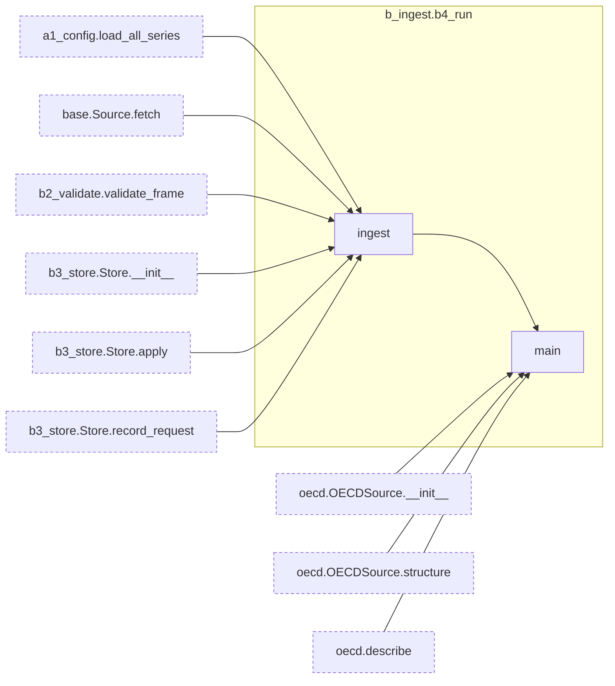

- **[`ingest(config_dir: Path=DEFAULT_CONFIG_DIR, data_dir: Path=DEFAULT_ROOT, only: list[str] | None=None, refresh_structures: bool=False) -> int`](../src/macroscan/b_ingest/b4_run.py#L20)** — Fetch every configured series and append changes. Returns the number of failures.
  - returns: `failures`: `int`
  - calls: [`a1_config.load_all_series`](#fn-a_core-a1_config-load_all_series), [`base.Source.fetch`](#fn-b_ingest-b1_sources-base-Source.fetch), [`b2_validate.validate_frame`](#fn-b_ingest-b2_validate-validate_frame), [`b3_store.Store.__init__`](#fn-b_ingest-b3_store-Store.__init__), [`b3_store.Store.apply`](#fn-b_ingest-b3_store-Store.apply), [`b3_store.Store.record_request`](#fn-b_ingest-b3_store-Store.record_request)
  - called by: [`main`](#fn-b_ingest-b4_run-main)
- **[`main(argv: list[str] | None=None) -> int`](../src/macroscan/b_ingest/b4_run.py#L70)** — Parse arguments and run `ingest` or `describe`; returns the exit code.
  - returns: `1 if ingest(args.config_dir, args.dat...`, `0`: `int`
  - calls: [`oecd.OECDSource.__init__`](#fn-b_ingest-b1_sources-oecd-OECDSource.__init__), [`oecd.OECDSource.structure`](#fn-b_ingest-b1_sources-oecd-OECDSource.structure), [`oecd.describe`](#fn-b_ingest-b1_sources-oecd-describe), [`ingest`](#fn-b_ingest-b4_run-ingest)

### [`c_transform.c1_load`](../src/macroscan/c_transform/c1_load.py)

Pull the ingested data into the transform stage.

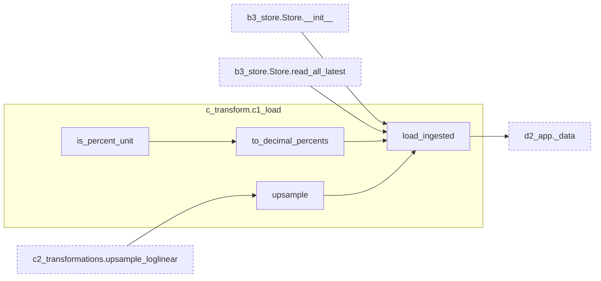

- **[`load_ingested(data_dir: Path=DEFAULT_ROOT, frequencies: list[str] | None=None) -> dict[str, pd.DataFrame]`](../src/macroscan/c_transform/c1_load.py#L27)** — Latest ingested data as {frequency: long frame}, skipping frequencies with nothing stored.
  - returns: `{f: df for f, df in frames.items() if...`: `dict[str, pd.DataFrame]`
  - calls: [`b3_store.Store.__init__`](#fn-b_ingest-b3_store-Store.__init__), [`b3_store.Store.read_all_latest`](#fn-b_ingest-b3_store-Store.read_all_latest), [`to_decimal_percents`](#fn-c_transform-c1_load-to_decimal_percents), [`upsample`](#fn-c_transform-c1_load-upsample)
  - called by: [`d2_app._data`](#fn-d_visualization-d2_app-_data)
- **[`upsample(frames: dict[str, pd.DataFrame]) -> dict[str, pd.DataFrame]`](../src/macroscan/c_transform/c1_load.py#L38)** — `frames` plus each UPSAMPLED indicator's annual rows at its target frequency.
  - returns: `out`: `dict[str, pd.DataFrame]`
  - calls: [`c2_transformations.upsample_loglinear`](#fn-c_transform-c2_transformations-upsample_loglinear)
  - called by: [`load_ingested`](#fn-c_transform-c1_load-load_ingested)
- **[`is_percent_unit(unit: pd.Series) -> pd.Series`](../src/macroscan/c_transform/c1_load.py#L52)** — Whether each unit is a source percent code: OECD's PA (% per annum) or PT_* (% of something).
  - returns: `(unit == 'PA') | unit.str.startswith(...`: `pd.Series`
  - calls: *(none)*
  - called by: [`to_decimal_percents`](#fn-c_transform-c1_load-to_decimal_percents)
- **[`to_decimal_percents(df: pd.DataFrame) -> pd.DataFrame`](../src/macroscan/c_transform/c1_load.py#L57)** — `df` with percent values divided by 100 and their unit set to '%'.
  - returns: `df.assign(value=df['value'].where(~pc...`: `pd.DataFrame`
  - calls: [`is_percent_unit`](#fn-c_transform-c1_load-is_percent_unit)
  - called by: [`load_ingested`](#fn-c_transform-c1_load-load_ingested)

### [`c_transform.c2_transformations`](../src/macroscan/c_transform/c2_transformations.py)

Building blocks for derived indicators: pure functions over canonical long frames.

```mermaid
flowchart LR
  subgraph this["c_transform.c2_transformations"]
    n_c_transform_c2_transformations__combine["_combine"]
    n_c_transform_c2_transformations_add["add"]
    n_c_transform_c2_transformations_div["div"]
    n_c_transform_c2_transformations_ma["ma"]
    n_c_transform_c2_transformations_ma_change_pct_yoy["ma_change_pct_yoy"]
    n_c_transform_c2_transformations_sub["sub"]
    n_c_transform_c2_transformations_upsample_loglinear["upsample_loglinear"]
    n_c_transform_c2_transformations_yoy_pct["yoy_pct"]
  end
  n_a_core_a2_schema_PeriodInterval_periods_at["a2_schema.PeriodInterval.periods_at"]:::ext
  n_a_core_a2_schema_to_wide["a2_schema.to_wide"]:::ext
  n_c_transform_c1_load_upsample["c1_load.upsample"]:::ext
  n_c_transform_c3_derived_bus_debt_flow["c3_derived.bus_debt_flow"]:::ext
  n_c_transform_c3_derived_bus_debt_flow_gdp["c3_derived.bus_debt_flow_gdp"]:::ext
  n_c_transform_c3_derived_bus_debt_level["c3_derived.bus_debt_level"]:::ext
  n_c_transform_c3_derived_bus_debt_level_gdp["c3_derived.bus_debt_level_gdp"]:::ext
  n_c_transform_c3_derived_govt_debt_flow["c3_derived.govt_debt_flow"]:::ext
  n_c_transform_c3_derived_govt_debt_flow_gdp["c3_derived.govt_debt_flow_gdp"]:::ext
  n_c_transform_c3_derived_govt_debt_level_gdp["c3_derived.govt_debt_level_gdp"]:::ext
  n_c_transform_c3_derived_hh_debt_flow_gdp["c3_derived.hh_debt_flow_gdp"]:::ext
  n_c_transform_c3_derived_hh_debt_level_gdp["c3_derived.hh_debt_level_gdp"]:::ext
  n_c_transform_c3_derived_nominal_growth["c3_derived.nominal_growth"]:::ext
  n_c_transform_c3_derived_pgdp_growth["c3_derived.pgdp_growth"]:::ext
  n_c_transform_c3_derived_real_growth["c3_derived.real_growth"]:::ext
  n_c_transform_c3_derived_real_growth_ma_change["c3_derived.real_growth_ma_change"]:::ext
  n_c_transform_c2_transformations_upsample_loglinear --> n_c_transform_c1_load_upsample
  n_c_transform_c2_transformations__combine --> n_c_transform_c2_transformations_add
  n_c_transform_c2_transformations__combine --> n_c_transform_c2_transformations_div
  n_a_core_a2_schema_PeriodInterval_periods_at --> n_c_transform_c2_transformations_ma
  n_a_core_a2_schema_to_wide --> n_c_transform_c2_transformations_ma
  n_c_transform_c2_transformations__combine --> n_c_transform_c2_transformations_ma
  n_a_core_a2_schema_PeriodInterval_periods_at --> n_c_transform_c2_transformations_ma_change_pct_yoy
  n_c_transform_c2_transformations__combine --> n_c_transform_c2_transformations_ma_change_pct_yoy
  n_c_transform_c2_transformations_ma --> n_c_transform_c2_transformations_ma_change_pct_yoy
  n_c_transform_c2_transformations__combine --> n_c_transform_c2_transformations_sub
  n_a_core_a2_schema_to_wide --> n_c_transform_c2_transformations_upsample_loglinear
  n_c_transform_c2_transformations__combine --> n_c_transform_c2_transformations_yoy_pct
  n_c_transform_c2_transformations_add --> n_c_transform_c3_derived_bus_debt_flow
  n_c_transform_c2_transformations_div --> n_c_transform_c3_derived_bus_debt_flow_gdp
  n_c_transform_c2_transformations_add --> n_c_transform_c3_derived_bus_debt_level
  n_c_transform_c2_transformations_div --> n_c_transform_c3_derived_bus_debt_level_gdp
  n_c_transform_c2_transformations_add --> n_c_transform_c3_derived_govt_debt_flow
  n_c_transform_c2_transformations_div --> n_c_transform_c3_derived_govt_debt_flow_gdp
  n_c_transform_c2_transformations_div --> n_c_transform_c3_derived_govt_debt_level_gdp
  n_c_transform_c2_transformations_div --> n_c_transform_c3_derived_hh_debt_flow_gdp
  n_c_transform_c2_transformations_div --> n_c_transform_c3_derived_hh_debt_level_gdp
  n_c_transform_c2_transformations_yoy_pct --> n_c_transform_c3_derived_nominal_growth
  n_c_transform_c2_transformations_yoy_pct --> n_c_transform_c3_derived_pgdp_growth
  n_c_transform_c2_transformations_yoy_pct --> n_c_transform_c3_derived_real_growth
  n_c_transform_c2_transformations_ma_change_pct_yoy --> n_c_transform_c3_derived_real_growth_ma_change
  click n_a_core_a2_schema_PeriodInterval_periods_at href "#fn-a_core-a2_schema-PeriodInterval.periods_at"
  click n_a_core_a2_schema_to_wide href "#fn-a_core-a2_schema-to_wide"
  click n_c_transform_c1_load_upsample href "#fn-c_transform-c1_load-upsample"
  click n_c_transform_c2_transformations__combine href "#fn-c_transform-c2_transformations-_combine"
  click n_c_transform_c2_transformations_add href "#fn-c_transform-c2_transformations-add"
  click n_c_transform_c2_transformations_div href "#fn-c_transform-c2_transformations-div"
  click n_c_transform_c2_transformations_ma href "#fn-c_transform-c2_transformations-ma"
  click n_c_transform_c2_transformations_ma_change_pct_yoy href "#fn-c_transform-c2_transformations-ma_change_pct_yoy"
  click n_c_transform_c2_transformations_sub href "#fn-c_transform-c2_transformations-sub"
  click n_c_transform_c2_transformations_upsample_loglinear href "#fn-c_transform-c2_transformations-upsample_loglinear"
  click n_c_transform_c2_transformations_yoy_pct href "#fn-c_transform-c2_transformations-yoy_pct"
  click n_c_transform_c3_derived_bus_debt_flow href "#fn-c_transform-c3_derived-bus_debt_flow"
  click n_c_transform_c3_derived_bus_debt_flow_gdp href "#fn-c_transform-c3_derived-bus_debt_flow_gdp"
  click n_c_transform_c3_derived_bus_debt_level href "#fn-c_transform-c3_derived-bus_debt_level"
  click n_c_transform_c3_derived_bus_debt_level_gdp href "#fn-c_transform-c3_derived-bus_debt_level_gdp"
  click n_c_transform_c3_derived_govt_debt_flow href "#fn-c_transform-c3_derived-govt_debt_flow"
  click n_c_transform_c3_derived_govt_debt_flow_gdp href "#fn-c_transform-c3_derived-govt_debt_flow_gdp"
  click n_c_transform_c3_derived_govt_debt_level_gdp href "#fn-c_transform-c3_derived-govt_debt_level_gdp"
  click n_c_transform_c3_derived_hh_debt_flow_gdp href "#fn-c_transform-c3_derived-hh_debt_flow_gdp"
  click n_c_transform_c3_derived_hh_debt_level_gdp href "#fn-c_transform-c3_derived-hh_debt_level_gdp"
  click n_c_transform_c3_derived_nominal_growth href "#fn-c_transform-c3_derived-nominal_growth"
  click n_c_transform_c3_derived_pgdp_growth href "#fn-c_transform-c3_derived-pgdp_growth"
  click n_c_transform_c3_derived_real_growth href "#fn-c_transform-c3_derived-real_growth"
  click n_c_transform_c3_derived_real_growth_ma_change href "#fn-c_transform-c3_derived-real_growth_ma_change"
  classDef ext stroke-dasharray: 4 3
```

- **[`yoy_pct(df: pd.DataFrame) -> pd.DataFrame`](../src/macroscan/c_transform/c2_transformations.py#L22)** — Y/Y % change (as a decimal) per country; periods with no year-earlier value drop out.
  - returns: `_combine(df, year_ago, lambda now, th...`: `pd.DataFrame`
  - calls: [`_combine`](#fn-c_transform-c2_transformations-_combine)
  - called by: [`c3_derived.nominal_growth`](#fn-c_transform-c3_derived-nominal_growth), [`c3_derived.pgdp_growth`](#fn-c_transform-c3_derived-pgdp_growth), [`c3_derived.real_growth`](#fn-c_transform-c3_derived-real_growth)
- **[`ma(df: pd.DataFrame, window: PeriodInterval) -> pd.DataFrame`](../src/macroscan/c_transform/c2_transformations.py#L28)** — Trailing mean over `window` per country; windows spanning a missing period drop out.
  - returns: `df.iloc[0:0]`, `_combine(df, means, lambda _, mean: m...`: `pd.DataFrame`
  - calls: [`a2_schema.PeriodInterval.periods_at`](#fn-a_core-a2_schema-PeriodInterval.periods_at), [`a2_schema.to_wide`](#fn-a_core-a2_schema-to_wide), [`_combine`](#fn-c_transform-c2_transformations-_combine)
  - called by: [`ma_change_pct_yoy`](#fn-c_transform-c2_transformations-ma_change_pct_yoy)
- **[`ma_change_pct_yoy(df: pd.DataFrame, front: PeriodInterval, back: PeriodInterval) -> pd.DataFrame`](../src/macroscan/c_transform/c2_transformations.py#L43)** — % change (as a decimal) of the latest `front` mean vs the mean over the `back` window before it.
  - returns: `df.iloc[0:0]`, `_combine(ma(df, front), back_means, l...`: `pd.DataFrame`
  - calls: [`a2_schema.PeriodInterval.periods_at`](#fn-a_core-a2_schema-PeriodInterval.periods_at), [`_combine`](#fn-c_transform-c2_transformations-_combine), [`ma`](#fn-c_transform-c2_transformations-ma)
  - called by: [`c3_derived.real_growth_ma_change`](#fn-c_transform-c3_derived-real_growth_ma_change)
- **[`upsample_loglinear(df: pd.DataFrame, frequency: str) -> pd.DataFrame`](../src/macroscan/c_transform/c2_transformations.py#L64)** — An annual series at `frequency`: each year's value at its last period, periods between interpolated
  - returns: `values.merge(meta, on='country').assi...`: `pd.DataFrame`
  - calls: [`a2_schema.to_wide`](#fn-a_core-a2_schema-to_wide)
  - called by: [`c1_load.upsample`](#fn-c_transform-c1_load-upsample)
- **[`add(a: pd.DataFrame, b: pd.DataFrame) -> pd.DataFrame`](../src/macroscan/c_transform/c2_transformations.py#L78)** — a + b per (country, period).
  - returns: `_combine(a, b, lambda x, y: x + y)`: `pd.DataFrame`
  - calls: [`_combine`](#fn-c_transform-c2_transformations-_combine)
  - called by: [`c3_derived.bus_debt_flow`](#fn-c_transform-c3_derived-bus_debt_flow), [`c3_derived.bus_debt_level`](#fn-c_transform-c3_derived-bus_debt_level), [`c3_derived.govt_debt_flow`](#fn-c_transform-c3_derived-govt_debt_flow)
- **[`sub(a: pd.DataFrame, b: pd.DataFrame) -> pd.DataFrame`](../src/macroscan/c_transform/c2_transformations.py#L83)** — a - b per (country, period).
  - returns: `_combine(a, b, lambda x, y: x - y)`: `pd.DataFrame`
  - calls: [`_combine`](#fn-c_transform-c2_transformations-_combine)
- **[`div(a: pd.DataFrame, b: pd.DataFrame) -> pd.DataFrame`](../src/macroscan/c_transform/c2_transformations.py#L88)** — a / b per (country, period); a % (as a decimal) when a is a part of b.
  - returns: `_combine(a, b, lambda x, y: x / y)`: `pd.DataFrame`
  - calls: [`_combine`](#fn-c_transform-c2_transformations-_combine)
  - called by: [`c3_derived.bus_debt_flow_gdp`](#fn-c_transform-c3_derived-bus_debt_flow_gdp), [`c3_derived.bus_debt_level_gdp`](#fn-c_transform-c3_derived-bus_debt_level_gdp), [`c3_derived.govt_debt_flow_gdp`](#fn-c_transform-c3_derived-govt_debt_flow_gdp), [`c3_derived.govt_debt_level_gdp`](#fn-c_transform-c3_derived-govt_debt_level_gdp), [`c3_derived.hh_debt_flow_gdp`](#fn-c_transform-c3_derived-hh_debt_flow_gdp), [`c3_derived.hh_debt_level_gdp`](#fn-c_transform-c3_derived-hh_debt_level_gdp)
- **[`_combine(a: pd.DataFrame, b: pd.DataFrame, op: Callable[[pd.Series, pd.Series], pd.Series]) -> pd.DataFrame`](../src/macroscan/c_transform/c2_transformations.py#L93)** — a's rows where b has the same (country, period), with value = op(a, b); NaN results drop out.
  - returns: `out.dropna(subset=['value']).reset_in...`: `pd.DataFrame`
  - calls: *(none)*
  - called by: [`add`](#fn-c_transform-c2_transformations-add), [`div`](#fn-c_transform-c2_transformations-div), [`ma`](#fn-c_transform-c2_transformations-ma), [`ma_change_pct_yoy`](#fn-c_transform-c2_transformations-ma_change_pct_yoy), [`sub`](#fn-c_transform-c2_transformations-sub), [`yoy_pct`](#fn-c_transform-c2_transformations-yoy_pct)

### [`c_transform.c3_derived`](../src/macroscan/c_transform/c3_derived.py)

Derived indicators, defined in code: one recipe per derived Indicator.

```mermaid
flowchart LR
  subgraph this["c_transform.c3_derived"]
    n_c_transform_c3_derived_apply_derivations["apply_derivations"]
    n_c_transform_c3_derived_bus_debt_flow["bus_debt_flow"]
    n_c_transform_c3_derived_bus_debt_flow_gdp["bus_debt_flow_gdp"]
    n_c_transform_c3_derived_bus_debt_level["bus_debt_level"]
    n_c_transform_c3_derived_bus_debt_level_gdp["bus_debt_level_gdp"]
    n_c_transform_c3_derived_derivation["derivation"]
    n_c_transform_c3_derived_derived["derived"]
    n_c_transform_c3_derived_govt_debt_flow["govt_debt_flow"]
    n_c_transform_c3_derived_govt_debt_flow_gdp["govt_debt_flow_gdp"]
    n_c_transform_c3_derived_govt_debt_level_gdp["govt_debt_level_gdp"]
    n_c_transform_c3_derived_hh_debt_flow_gdp["hh_debt_flow_gdp"]
    n_c_transform_c3_derived_hh_debt_level_gdp["hh_debt_level_gdp"]
    n_c_transform_c3_derived_nominal_growth["nominal_growth"]
    n_c_transform_c3_derived_ordered["ordered"]
    n_c_transform_c3_derived_pgdp_growth["pgdp_growth"]
    n_c_transform_c3_derived_real_growth["real_growth"]
    n_c_transform_c3_derived_real_growth_ma_change["real_growth_ma_change"]
  end
  n_a_core_a2_schema_PeriodInterval_months["a2_schema.PeriodInterval.months"]:::ext
  n_a_core_a3_indicators_Indicator_parse["a3_indicators.Indicator.parse"]:::ext
  n_c_transform_c2_transformations_add["c2_transformations.add"]:::ext
  n_c_transform_c2_transformations_div["c2_transformations.div"]:::ext
  n_c_transform_c2_transformations_ma_change_pct_yoy["c2_transformations.ma_change_pct_yoy"]:::ext
  n_c_transform_c2_transformations_yoy_pct["c2_transformations.yoy_pct"]:::ext
  n_c_transform_c3_derived_Derivation["c3_derived.Derivation"]:::ext
  n_d_visualization_d2_app__data["d2_app._data"]:::ext
  n_c_transform_c3_derived_ordered --> n_c_transform_c3_derived_apply_derivations
  n_c_transform_c2_transformations_add --> n_c_transform_c3_derived_bus_debt_flow
  n_c_transform_c3_derived_derived --> n_c_transform_c3_derived_bus_debt_flow
  n_c_transform_c2_transformations_div --> n_c_transform_c3_derived_bus_debt_flow_gdp
  n_c_transform_c3_derived_derived --> n_c_transform_c3_derived_bus_debt_flow_gdp
  n_c_transform_c2_transformations_add --> n_c_transform_c3_derived_bus_debt_level
  n_c_transform_c3_derived_derived --> n_c_transform_c3_derived_bus_debt_level
  n_c_transform_c2_transformations_div --> n_c_transform_c3_derived_bus_debt_level_gdp
  n_c_transform_c3_derived_derived --> n_c_transform_c3_derived_bus_debt_level_gdp
  n_a_core_a3_indicators_Indicator_parse --> n_c_transform_c3_derived_derivation
  n_c_transform_c3_derived_Derivation --> n_c_transform_c3_derived_derivation
  n_c_transform_c3_derived_derivation --> n_c_transform_c3_derived_derived
  n_c_transform_c2_transformations_add --> n_c_transform_c3_derived_govt_debt_flow
  n_c_transform_c3_derived_derived --> n_c_transform_c3_derived_govt_debt_flow
  n_c_transform_c2_transformations_div --> n_c_transform_c3_derived_govt_debt_flow_gdp
  n_c_transform_c3_derived_derived --> n_c_transform_c3_derived_govt_debt_flow_gdp
  n_c_transform_c2_transformations_div --> n_c_transform_c3_derived_govt_debt_level_gdp
  n_c_transform_c3_derived_derived --> n_c_transform_c3_derived_govt_debt_level_gdp
  n_c_transform_c2_transformations_div --> n_c_transform_c3_derived_hh_debt_flow_gdp
  n_c_transform_c3_derived_derived --> n_c_transform_c3_derived_hh_debt_flow_gdp
  n_c_transform_c2_transformations_div --> n_c_transform_c3_derived_hh_debt_level_gdp
  n_c_transform_c3_derived_derived --> n_c_transform_c3_derived_hh_debt_level_gdp
  n_c_transform_c2_transformations_yoy_pct --> n_c_transform_c3_derived_nominal_growth
  n_c_transform_c3_derived_derived --> n_c_transform_c3_derived_nominal_growth
  n_c_transform_c2_transformations_yoy_pct --> n_c_transform_c3_derived_pgdp_growth
  n_c_transform_c3_derived_derived --> n_c_transform_c3_derived_pgdp_growth
  n_c_transform_c2_transformations_yoy_pct --> n_c_transform_c3_derived_real_growth
  n_c_transform_c3_derived_derived --> n_c_transform_c3_derived_real_growth
  n_a_core_a2_schema_PeriodInterval_months --> n_c_transform_c3_derived_real_growth_ma_change
  n_c_transform_c2_transformations_ma_change_pct_yoy --> n_c_transform_c3_derived_real_growth_ma_change
  n_c_transform_c3_derived_derived --> n_c_transform_c3_derived_real_growth_ma_change
  n_c_transform_c3_derived_apply_derivations --> n_d_visualization_d2_app__data
  click n_a_core_a2_schema_PeriodInterval_months href "#fn-a_core-a2_schema-PeriodInterval.months"
  click n_a_core_a3_indicators_Indicator_parse href "#fn-a_core-a3_indicators-Indicator.parse"
  click n_c_transform_c2_transformations_add href "#fn-c_transform-c2_transformations-add"
  click n_c_transform_c2_transformations_div href "#fn-c_transform-c2_transformations-div"
  click n_c_transform_c2_transformations_ma_change_pct_yoy href "#fn-c_transform-c2_transformations-ma_change_pct_yoy"
  click n_c_transform_c2_transformations_yoy_pct href "#fn-c_transform-c2_transformations-yoy_pct"
  click n_c_transform_c3_derived_Derivation href "#cls-Derivation"
  click n_c_transform_c3_derived_apply_derivations href "#fn-c_transform-c3_derived-apply_derivations"
  click n_c_transform_c3_derived_bus_debt_flow href "#fn-c_transform-c3_derived-bus_debt_flow"
  click n_c_transform_c3_derived_bus_debt_flow_gdp href "#fn-c_transform-c3_derived-bus_debt_flow_gdp"
  click n_c_transform_c3_derived_bus_debt_level href "#fn-c_transform-c3_derived-bus_debt_level"
  click n_c_transform_c3_derived_bus_debt_level_gdp href "#fn-c_transform-c3_derived-bus_debt_level_gdp"
  click n_c_transform_c3_derived_derivation href "#fn-c_transform-c3_derived-derivation"
  click n_c_transform_c3_derived_derived href "#fn-c_transform-c3_derived-derived"
  click n_c_transform_c3_derived_govt_debt_flow href "#fn-c_transform-c3_derived-govt_debt_flow"
  click n_c_transform_c3_derived_govt_debt_flow_gdp href "#fn-c_transform-c3_derived-govt_debt_flow_gdp"
  click n_c_transform_c3_derived_govt_debt_level_gdp href "#fn-c_transform-c3_derived-govt_debt_level_gdp"
  click n_c_transform_c3_derived_hh_debt_flow_gdp href "#fn-c_transform-c3_derived-hh_debt_flow_gdp"
  click n_c_transform_c3_derived_hh_debt_level_gdp href "#fn-c_transform-c3_derived-hh_debt_level_gdp"
  click n_c_transform_c3_derived_nominal_growth href "#fn-c_transform-c3_derived-nominal_growth"
  click n_c_transform_c3_derived_ordered href "#fn-c_transform-c3_derived-ordered"
  click n_c_transform_c3_derived_pgdp_growth href "#fn-c_transform-c3_derived-pgdp_growth"
  click n_c_transform_c3_derived_real_growth href "#fn-c_transform-c3_derived-real_growth"
  click n_c_transform_c3_derived_real_growth_ma_change href "#fn-c_transform-c3_derived-real_growth_ma_change"
  click n_d_visualization_d2_app__data href "#fn-d_visualization-d2_app-_data"
  classDef ext stroke-dasharray: 4 3
```

- **[`derivation(func: Callable[..., pd.DataFrame], unit: str | None=None) -> Derivation`](../src/macroscan/c_transform/c3_derived.py#L38)** — A Derivation read off `func`: its name and parameter names must be lower-cased Indicators.
  - returns: `Derivation(indicator, inputs, func, u...`: `Derivation`
  - calls: [`a3_indicators.Indicator.parse`](#fn-a_core-a3_indicators-Indicator.parse), [`Derivation`](#cls-Derivation)
  - called by: [`derived`](#fn-c_transform-c3_derived-derived)
- **[`derived(*, unit: str | None=None) -> Callable[[Callable[..., pd.DataFrame]], Callable[..., pd.DataFrame]]`](../src/macroscan/c_transform/c3_derived.py#L47)** — Decorator: register the function in DERIVED as the recipe for the Indicator it is named after.
  - returns: `register`: `Callable[[Callable[..., pd.DataFrame]], Callable[..., pd.DataFrame]]`
  - calls: [`derivation`](#fn-c_transform-c3_derived-derivation)
  - called by: [`bus_debt_flow`](#fn-c_transform-c3_derived-bus_debt_flow), [`bus_debt_flow_gdp`](#fn-c_transform-c3_derived-bus_debt_flow_gdp), [`bus_debt_level`](#fn-c_transform-c3_derived-bus_debt_level), [`bus_debt_level_gdp`](#fn-c_transform-c3_derived-bus_debt_level_gdp), [`govt_debt_flow`](#fn-c_transform-c3_derived-govt_debt_flow), [`govt_debt_flow_gdp`](#fn-c_transform-c3_derived-govt_debt_flow_gdp), [`govt_debt_level_gdp`](#fn-c_transform-c3_derived-govt_debt_level_gdp), [`hh_debt_flow_gdp`](#fn-c_transform-c3_derived-hh_debt_flow_gdp), [`hh_debt_level_gdp`](#fn-c_transform-c3_derived-hh_debt_level_gdp), [`nominal_growth`](#fn-c_transform-c3_derived-nominal_growth), [`pgdp_growth`](#fn-c_transform-c3_derived-pgdp_growth), [`real_growth`](#fn-c_transform-c3_derived-real_growth), [`real_growth_ma_change`](#fn-c_transform-c3_derived-real_growth_ma_change)
- **[`ordered(derivations: dict[Indicator, Derivation]=DERIVED) -> list[Derivation]`](../src/macroscan/c_transform/c3_derived.py#L58)** — The derivations, each after any it builds on; raises graphlib.CycleError on a cycle.
  - returns: `[derivations[i] for i in TopologicalS...`: `list[Derivation]`
  - calls: *(none)*
  - called by: [`apply_derivations`](#fn-c_transform-c3_derived-apply_derivations)
- **[`lineage(indicator: Indicator, derivations: dict[Indicator, Derivation]=DERIVED) -> dict[Indicator, dict]`](../src/macroscan/c_transform/c3_derived.py#L64)** — `indicator`'s inputs as a nested {input: its inputs} tree; non-derived inputs are leaves ({}).
  - returns: `{} if d is None else {i: lineage(i, d...`: `dict[Indicator, dict]`
  - calls: *(none)*
- **[`apply_derivations(data: dict[str, pd.DataFrame], derivations: dict[Indicator, Derivation]=DERIVED) -> dict[str, pd.DataFrame]`](../src/macroscan/c_transform/c3_derived.py#L70)** — `data` ({frequency: long frame}) plus each derived indicator; inputs are not modified.
  - returns: `out`: `dict[str, pd.DataFrame]`
  - calls: [`ordered`](#fn-c_transform-c3_derived-ordered)
  - called by: [`d2_app._data`](#fn-d_visualization-d2_app-_data)
- **[`real_growth(real_gdp)`](../src/macroscan/c_transform/c3_derived.py#L99)** — *(no docstring)*
  - returns: `yoy_pct(real_gdp)`: *(unannotated)*
  - calls: [`c2_transformations.yoy_pct`](#fn-c_transform-c2_transformations-yoy_pct), [`derived`](#fn-c_transform-c3_derived-derived)
- **[`real_growth_ma_change(real_gdp)`](../src/macroscan/c_transform/c3_derived.py#L105)** — *(no docstring)*
  - returns: `ma_change_pct_yoy(real_gdp, PeriodInt...`: *(unannotated)*
  - calls: [`a2_schema.PeriodInterval.months`](#fn-a_core-a2_schema-PeriodInterval.months), [`c2_transformations.ma_change_pct_yoy`](#fn-c_transform-c2_transformations-ma_change_pct_yoy), [`derived`](#fn-c_transform-c3_derived-derived)
- **[`nominal_growth(nominal_gdp)`](../src/macroscan/c_transform/c3_derived.py#L110)** — *(no docstring)*
  - returns: `yoy_pct(nominal_gdp)`: *(unannotated)*
  - calls: [`c2_transformations.yoy_pct`](#fn-c_transform-c2_transformations-yoy_pct), [`derived`](#fn-c_transform-c3_derived-derived)
- **[`bus_debt_level(bus_loans, bus_debt_securities)`](../src/macroscan/c_transform/c3_derived.py#L115)** — *(no docstring)*
  - returns: `add(bus_loans, bus_debt_securities)`: *(unannotated)*
  - calls: [`c2_transformations.add`](#fn-c_transform-c2_transformations-add), [`derived`](#fn-c_transform-c3_derived-derived)
- **[`hh_debt_level_gdp(hh_debt_level, nominal_gdp)`](../src/macroscan/c_transform/c3_derived.py#L121)** — *(no docstring)*
  - returns: `div(hh_debt_level, nominal_gdp)`: *(unannotated)*
  - calls: [`c2_transformations.div`](#fn-c_transform-c2_transformations-div), [`derived`](#fn-c_transform-c3_derived-derived)
- **[`bus_debt_level_gdp(bus_debt_level, nominal_gdp)`](../src/macroscan/c_transform/c3_derived.py#L126)** — *(no docstring)*
  - returns: `div(bus_debt_level, nominal_gdp)`: *(unannotated)*
  - calls: [`c2_transformations.div`](#fn-c_transform-c2_transformations-div), [`derived`](#fn-c_transform-c3_derived-derived)
- **[`govt_debt_level_gdp(govt_debt_level, nominal_gdp)`](../src/macroscan/c_transform/c3_derived.py#L131)** — *(no docstring)*
  - returns: `div(govt_debt_level, nominal_gdp)`: *(unannotated)*
  - calls: [`c2_transformations.div`](#fn-c_transform-c2_transformations-div), [`derived`](#fn-c_transform-c3_derived-derived)
- **[`pgdp_growth(pgdp)`](../src/macroscan/c_transform/c3_derived.py#L137)** — *(no docstring)*
  - returns: `yoy_pct(pgdp)`: *(unannotated)*
  - calls: [`c2_transformations.yoy_pct`](#fn-c_transform-c2_transformations-yoy_pct), [`derived`](#fn-c_transform-c3_derived-derived)
- **[`bus_debt_flow(bus_loans_flow, bus_debt_securities_flow)`](../src/macroscan/c_transform/c3_derived.py#L142)** — *(no docstring)*
  - returns: `add(bus_loans_flow, bus_debt_securiti...`: *(unannotated)*
  - calls: [`c2_transformations.add`](#fn-c_transform-c2_transformations-add), [`derived`](#fn-c_transform-c3_derived-derived)
- **[`govt_debt_flow(govt_loans_flow, govt_debt_securities_flow)`](../src/macroscan/c_transform/c3_derived.py#L147)** — *(no docstring)*
  - returns: `add(govt_loans_flow, govt_debt_securi...`: *(unannotated)*
  - calls: [`c2_transformations.add`](#fn-c_transform-c2_transformations-add), [`derived`](#fn-c_transform-c3_derived-derived)
- **[`hh_debt_flow_gdp(hh_debt_flow, nominal_gdp)`](../src/macroscan/c_transform/c3_derived.py#L154)** — *(no docstring)*
  - returns: `div(hh_debt_flow, nominal_gdp)`: *(unannotated)*
  - calls: [`c2_transformations.div`](#fn-c_transform-c2_transformations-div), [`derived`](#fn-c_transform-c3_derived-derived)
- **[`bus_debt_flow_gdp(bus_debt_flow, nominal_gdp)`](../src/macroscan/c_transform/c3_derived.py#L159)** — *(no docstring)*
  - returns: `div(bus_debt_flow, nominal_gdp)`: *(unannotated)*
  - calls: [`c2_transformations.div`](#fn-c_transform-c2_transformations-div), [`derived`](#fn-c_transform-c3_derived-derived)
- **[`govt_debt_flow_gdp(govt_debt_flow, nominal_gdp)`](../src/macroscan/c_transform/c3_derived.py#L164)** — *(no docstring)*
  - returns: `div(govt_debt_flow, nominal_gdp)`: *(unannotated)*
  - calls: [`c2_transformations.div`](#fn-c_transform-c2_transformations-div), [`derived`](#fn-c_transform-c3_derived-derived)
- **[class `Derivation`](../src/macroscan/c_transform/c3_derived.py#L27)** — How `indicator` is computed: `func` called with one long frame per input, by lower-cased name.

### [`d_visualization.d1_frames`](../src/macroscan/d_visualization/d1_frames.py)

Shape the ingested data for the app: a latest-value table and chartable series.

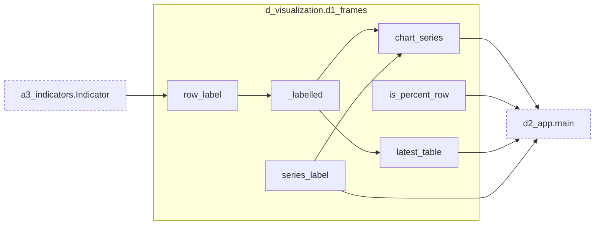

- **[`row_label(indicator: str, frequency: str) -> str`](../src/macroscan/d_visualization/d1_frames.py#L14)** — Table row for an (indicator, frequency), by its label: 'REAL_GDP' -> 'Real GDP (Q)'.
  - returns: `f'{Indicator(indicator).label} ({freq...`: `str`
  - calls: [`a3_indicators.Indicator`](#cls-Indicator)
  - called by: [`_labelled`](#fn-d_visualization-d1_frames-_labelled)
- **[`series_label(row: str, country: str) -> str`](../src/macroscan/d_visualization/d1_frames.py#L19)** — Chart line name for one table cell: 'USA · Real GDP (Q)'.
  - returns: `f'{country} · {row}'`: `str`
  - calls: *(none)*
  - called by: [`chart_series`](#fn-d_visualization-d1_frames-chart_series), [`d2_app.main`](#fn-d_visualization-d2_app-main)
- **[`is_percent_row(row: str) -> bool`](../src/macroscan/d_visualization/d1_frames.py#L24)** — Whether a table row holds percents (stored as decimals): its indicator's label has a '%'.
  - returns: `'%' in row`: `bool`
  - calls: *(none)*
  - called by: [`d2_app.main`](#fn-d_visualization-d2_app-main)
- **[`latest_table(data: dict[str, pd.DataFrame], countries: list[str], indicators: list[str] | None=None) -> pd.DataFrame`](../src/macroscan/d_visualization/d1_frames.py#L29)** — Last value per indicator (rows) and country (columns, in `countries` order).
  - returns: `pd.DataFrame(columns=countries, dtype...`, `wide.sort_index()`: `pd.DataFrame`
  - calls: [`_labelled`](#fn-d_visualization-d1_frames-_labelled)
  - called by: [`d2_app.main`](#fn-d_visualization-d2_app-main)
- **[`chart_series(data: dict[str, pd.DataFrame], picks: list[tuple[str, str]]) -> pd.DataFrame`](../src/macroscan/d_visualization/d1_frames.py#L44)** — One column per (row label, country) pick, indexed by timestamp; frequencies are outer-joined.
  - returns: `chart`: `pd.DataFrame`
  - calls: [`_labelled`](#fn-d_visualization-d1_frames-_labelled), [`series_label`](#fn-d_visualization-d1_frames-series_label)
  - called by: [`d2_app.main`](#fn-d_visualization-d2_app-main)
- **[`_labelled(df: pd.DataFrame) -> pd.DataFrame`](../src/macroscan/d_visualization/d1_frames.py#L62)** — A long frame with its table row label added.
  - returns: `df.assign(row=[row_label(i, f) for i,...`: `pd.DataFrame`
  - calls: [`row_label`](#fn-d_visualization-d1_frames-row_label)
  - called by: [`chart_series`](#fn-d_visualization-d1_frames-chart_series), [`latest_table`](#fn-d_visualization-d1_frames-latest_table)

### [`d_visualization.d2_app`](../src/macroscan/d_visualization/d2_app.py)

Streamlit app: latest values by indicator and country; click cells to chart them.

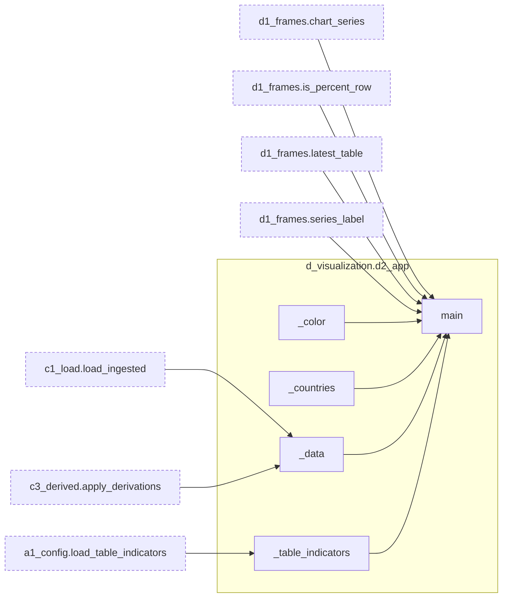

- **[`_data() -> dict[str, pd.DataFrame]`](../src/macroscan/d_visualization/d2_app.py#L30)** — Ingested data plus the derived indicators, built once per session.
  - returns: `apply_derivations(load_ingested(DEFAU...`: `dict[str, pd.DataFrame]`
  - calls: [`c1_load.load_ingested`](#fn-c_transform-c1_load-load_ingested), [`c3_derived.apply_derivations`](#fn-c_transform-c3_derived-apply_derivations)
  - called by: [`main`](#fn-d_visualization-d2_app-main)
- **[`_countries() -> list[str]`](../src/macroscan/d_visualization/d2_app.py#L35)** — Country codes in definition order.
  - returns: `list(Country)`: `list[str]`
  - calls: *(none)*
  - called by: [`main`](#fn-d_visualization-d2_app-main)
- **[`_table_indicators() -> list[str]`](../src/macroscan/d_visualization/d2_app.py#L41)** — Indicators shown in the table, from config.
  - returns: `load_table_indicators(DEFAULT_CONFIG_...`: `list[str]`
  - calls: [`a1_config.load_table_indicators`](#fn-a_core-a1_config-load_table_indicators)
  - called by: [`main`](#fn-d_visualization-d2_app-main)
- **[`_color(label: str, picks: list[str]) -> str`](../src/macroscan/d_visualization/d2_app.py#L46)** — The color for a charted series: its existing one, else the first palette color nobody is using.
  - returns: `colors[label]`: `str`
  - calls: *(none)*
  - called by: [`main`](#fn-d_visualization-d2_app-main)
- **[`main() -> None`](../src/macroscan/d_visualization/d2_app.py#L57)** — Render the table and the chart of picked cells.
  - returns: *(none)*
  - calls: [`d1_frames.chart_series`](#fn-d_visualization-d1_frames-chart_series), [`d1_frames.is_percent_row`](#fn-d_visualization-d1_frames-is_percent_row), [`d1_frames.latest_table`](#fn-d_visualization-d1_frames-latest_table), [`d1_frames.series_label`](#fn-d_visualization-d1_frames-series_label), [`_color`](#fn-d_visualization-d2_app-_color), [`_countries`](#fn-d_visualization-d2_app-_countries), [`_data`](#fn-d_visualization-d2_app-_data), [`_table_indicators`](#fn-d_visualization-d2_app-_table_indicators)

