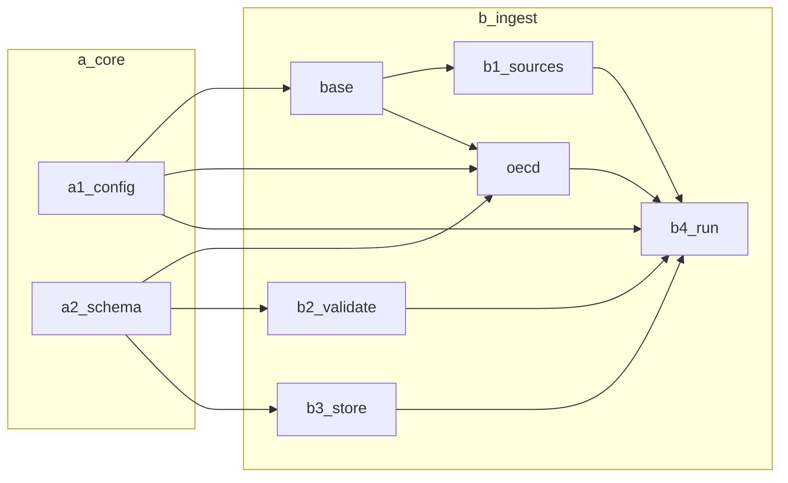
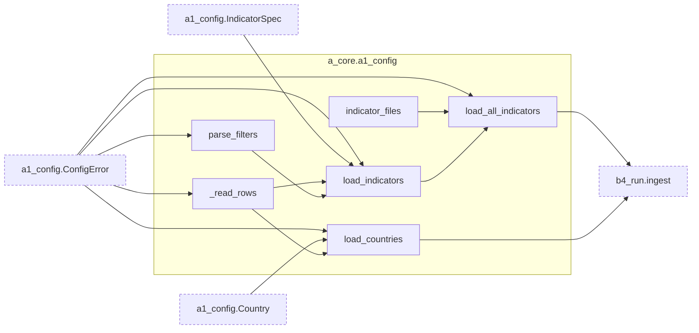
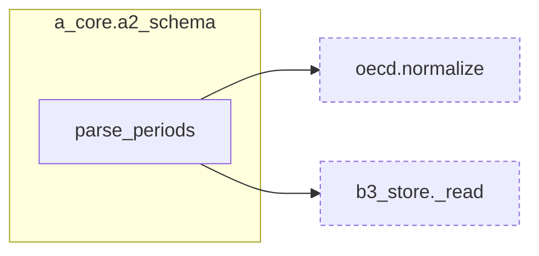
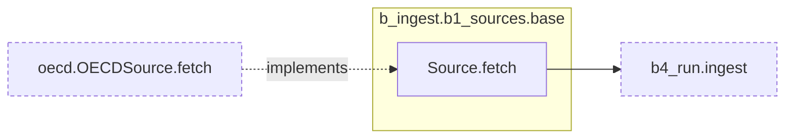
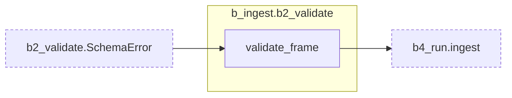
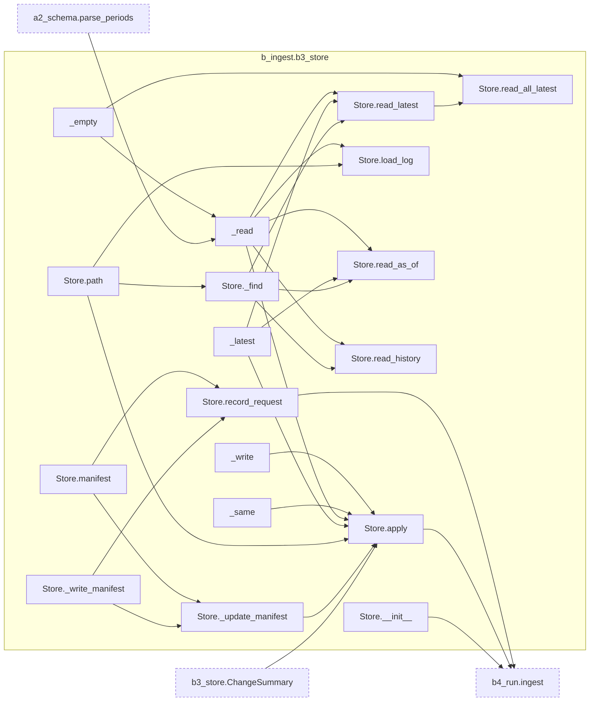
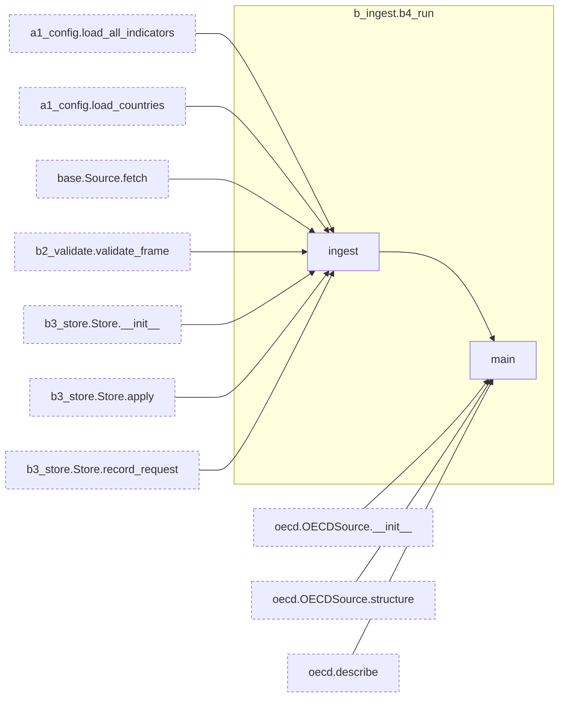

<!-- Generated by scripts/gen_docs.py. Do not edit. -->

# MacroScan architecture

## Module dependencies

| Module | What it does |
|---|---|
| [`a_core.a1_config`](#mod-a_core-a1_config) | Load the CSV config files: which countries and which indicators to ingest. |
| [`a_core.a2_schema`](#mod-a_core-a2_schema) | The canonical long-format table every source produces, plus period helpers. |
| [`b_ingest.b1_sources`](#mod-b_ingest-b1_sources) | Data sources. Importing this package registers every source in SOURCES. |
| [`b_ingest.b1_sources.base`](#mod-b_ingest-b1_sources-base) | The interface every data source implements. |
| [`b_ingest.b1_sources.oecd`](#mod-b_ingest-b1_sources-oecd) | OECD SDMX REST API (https://sdmx.oecd.org/public/rest). |
| [`b_ingest.b2_validate`](#mod-b_ingest-b2_validate) | Check a source's fetch() output matches the canonical schema before storing it. |
| [`b_ingest.b3_store`](#mod-b_ingest-b3_store) | Append-only change log of observations, one Parquet file per indicator. |
| [`b_ingest.b4_run`](#mod-b_ingest-b4_run) | Command line entry point: `macroscan ingest` and `macroscan describe`. |

| Class | What it does |
|---|---|
| [`ConfigError`](#cls-ConfigError) | Raised when a config CSV is missing, malformed or inconsistent. |
| [`Country`](#cls-Country) | A country to ingest, identified by its ISO3 code. |
| [`IndicatorSpec`](#cls-IndicatorSpec) | One configured indicator: where to fetch it from and how to filter it. |
| [`Source`](#cls-Source) | A data provider. fetch() returns a frame with a2_schema.FETCH_COLUMNS. |
| [`OECDError`](#cls-OECDError) | Raised for OECD API failures and unexpected responses. |
| [`Dataflow`](#cls-Dataflow) | Reference to an OECD dataflow: agency, dataflow id and version. |
| [`Dimension`](#cls-Dimension) | One dimension of a dataflow's key, with its codelist. |
| [`Structure`](#cls-Structure) | The parts of a dataflow's structure needed to build keys and describe it. |
| [`OECDClient`](#cls-OECDClient) | requests wrapper with backoff on 429/5xx and a minimum gap between calls. |
| [`OECDSource`](#cls-OECDSource) | Source for OECD indicators configured as named dimension filters. |
| [`SchemaError`](#cls-SchemaError) | Raised when a fetched frame doesn't match the canonical schema. |
| [`ChangeSummary`](#cls-ChangeSummary) | What one ingest of an indicator changed. |
| [`Store`](#cls-Store) | Reads and writes the per-indicator change logs and the manifest. |

## Classes

```mermaid
classDiagram
  class ConfigError {
  }
  ValueError <|-- ConfigError
  class Country {
    code: str
    name: str
  }
  class IndicatorSpec {
    id: str
    name: str
    source: str
    dataflow: str
    filters: dict~str, tuple~str, ...~~
    start: str or None
    end: str or None
  }
  class Source {
    name: str
    fetch(self, spec: IndicatorSpec, countries: list~str~) : pd.DataFrame
  }
  class OECDError {
  }
  RuntimeError <|-- OECDError
  class Dataflow {
    agency: str
    id: str
    version: str
    parse(cls, text: str) : Dataflow
    label(self) : str
  }
  class Dimension {
    id: str
    position: int
    name: str
    codes: dict~str, str~
    available: list~str~ or None
  }
  class Structure {
    dataflow: str
    name: str
    dimensions: list~Dimension~
    dimension(self, dim_id: str) : Dimension
    to_json(self) : str
    from_json(cls, text: str) : Structure
  }
  class OECDClient {
    get(self, path: str, accept: str, params: dict or None=None) : requests.Response
  }
  class OECDSource {
    structure(self, dataflow: str or Dataflow) : Structure
    fetch(self, spec: IndicatorSpec, countries: list~str~) : pd.DataFrame
  }
  Source <|-- OECDSource
  class SchemaError {
  }
  ValueError <|-- SchemaError
  class ChangeSummary {
    new: int
    revised: int
    withdrawn: int
    rows_in_pull: int
    countries_missing: list~str~
    appended(self) : int
  }
  class Store {
    path(self, source: str, indicator: str) : Path
    _find(self, indicator: str, source: str or None) : Path
    load_log(self, source: str, indicator: str) : pd.DataFrame
    apply(self, pulled: pd.DataFrame, source: str, indicator: str, requested_countries: list~str~ or None=None, pulled_at: datetime or None=None) : ChangeSummary
    record_request(self, source: str, indicator: str, url: str or None) : None
    read_history(self, indicator: str, source: str or None=None, country: str or None=None, period: str or None=None) : pd.DataFrame
    read_as_of(self, indicator: str, when, source: str or None=None) : pd.DataFrame
    read_latest(self, indicator: str, source: str or None=None) : pd.DataFrame
    read_all_latest(self, source: str or None=None) : pd.DataFrame
    manifest_path(self) : Path
    manifest(self) : dict
    _write_manifest(self, manifest: dict) : None
    _update_manifest(self, source, indicator, summary: ChangeSummary, pulled_at, path: Path) : None
  }
  click ConfigError href "#cls-ConfigError"
  click Country href "#cls-Country"
  click IndicatorSpec href "#cls-IndicatorSpec"
  click Source href "#cls-Source"
  click OECDError href "#cls-OECDError"
  click Dataflow href "#cls-Dataflow"
  click Dimension href "#cls-Dimension"
  click Structure href "#cls-Structure"
  click OECDClient href "#cls-OECDClient"
  click OECDSource href "#cls-OECDSource"
  click SchemaError href "#cls-SchemaError"
  click ChangeSummary href "#cls-ChangeSummary"
  click Store href "#cls-Store"
```

## Reference

### [`a_core.a1_config`](../src/macroscan/a_core/a1_config.py)

Load the CSV config files: which countries and which indicators to ingest.

- **[`parse_filters(text: str) -> dict[str, tuple[str, ...]]`](../src/macroscan/a_core/a1_config.py#L40)** — Parse 'FREQ=Q;SEX=M+F' into {'FREQ': ('Q',), 'SEX': ('M', 'F')}.
  - returns: `filters`: `dict[str, tuple[str, ...]]`
  - calls: [`ConfigError`](#cls-ConfigError)
  - called by: [`load_indicators`](#fn-a_core-a1_config-load_indicators)
- **[`_read_rows(path: Path, required: set[str]) -> list[dict[str, str]]`](../src/macroscan/a_core/a1_config.py#L60)** — Read a CSV into stripped dicts, skipping blank and '#'-commented rows.
  - returns: `[r for r in rows if any(r.values()) a...`: `list[dict[str, str]]`
  - calls: [`ConfigError`](#cls-ConfigError)
  - called by: [`load_countries`](#fn-a_core-a1_config-load_countries), [`load_indicators`](#fn-a_core-a1_config-load_indicators)
- **[`load_countries(path: Path) -> list[Country]`](../src/macroscan/a_core/a1_config.py#L74)** — Load and validate the countries list (ISO3 codes, no duplicates).
  - returns: `countries`: `list[Country]`
  - calls: [`ConfigError`](#cls-ConfigError), [`Country`](#cls-Country), [`_read_rows`](#fn-a_core-a1_config-_read_rows)
  - called by: [`b4_run.ingest`](#fn-b_ingest-b4_run-ingest)
- **[`load_indicators(path: Path, source: str) -> list[IndicatorSpec]`](../src/macroscan/a_core/a1_config.py#L91)** — Load and validate one source's indicators CSV into IndicatorSpecs.
  - returns: `specs`: `list[IndicatorSpec]`
  - calls: [`ConfigError`](#cls-ConfigError), [`IndicatorSpec`](#cls-IndicatorSpec), [`_read_rows`](#fn-a_core-a1_config-_read_rows), [`parse_filters`](#fn-a_core-a1_config-parse_filters)
  - called by: [`load_all_indicators`](#fn-a_core-a1_config-load_all_indicators)
- **[`indicator_files(config_dir: Path) -> dict[str, Path]`](../src/macroscan/a_core/a1_config.py#L122)** — Map source name -> its indicators CSV, e.g. {'oecd': config/02_oecd_indicators.csv}.
  - returns: `files`: `dict[str, Path]`
  - calls: *(none)*
  - called by: [`load_all_indicators`](#fn-a_core-a1_config-load_all_indicators)
- **[`load_all_indicators(config_dir: Path=DEFAULT_CONFIG_DIR) -> list[IndicatorSpec]`](../src/macroscan/a_core/a1_config.py#L132)** — Load every *_indicators.csv in config_dir; ids must be unique across sources.
  - returns: `specs`: `list[IndicatorSpec]`
  - calls: [`ConfigError`](#cls-ConfigError), [`indicator_files`](#fn-a_core-a1_config-indicator_files), [`load_indicators`](#fn-a_core-a1_config-load_indicators)
  - called by: [`b4_run.ingest`](#fn-b_ingest-b4_run-ingest)
- **[class `ConfigError`](../src/macroscan/a_core/a1_config.py#L14)** — Raised when a config CSV is missing, malformed or inconsistent.
- **[class `Country`](../src/macroscan/a_core/a1_config.py#L19)** — A country to ingest, identified by its ISO3 code.
- **[class `IndicatorSpec`](../src/macroscan/a_core/a1_config.py#L26)** — One configured indicator: where to fetch it from and how to filter it.

### [`a_core.a2_schema`](../src/macroscan/a_core/a2_schema.py)

The canonical long-format table every source produces, plus period helpers.

- **[`parse_periods(values: pd.Series | list[str], frequency: str) -> pd.Series`](../src/macroscan/a_core/a2_schema.py#L31)** — Parse period strings ('2024', '2024-Q1', '2024Q1', '2024-03') into a Period Series.
  - returns: `pd.Series(pd.PeriodIndex(text, freq=P...`: `pd.Series`
  - calls: *(none)*
  - called by: [`oecd.normalize`](#fn-b_ingest-b1_sources-oecd-normalize), [`b3_store._read`](#fn-b_ingest-b3_store-_read)
- **[`to_wide(df: pd.DataFrame, columns: str='country') -> pd.DataFrame`](../src/macroscan/a_core/a2_schema.py#L39)** — Pivot a long frame for one indicator into a PeriodIndex x country matrix.
  - returns: `wide.sort_index()`: `pd.DataFrame`
  - calls: *(none)*

### [`b_ingest.b1_sources`](../src/macroscan/b_ingest/b1_sources/__init__.py)

Data sources. Importing this package registers every source in SOURCES.

### [`b_ingest.b1_sources.base`](../src/macroscan/b_ingest/b1_sources/base.py)

The interface every data source implements.

- **[`register(cls: type[Source]) -> type[Source]`](../src/macroscan/b_ingest/b1_sources/base.py#L32)** — Class decorator that adds a Source to SOURCES under its `name`.
  - returns: `cls`: `type[Source]`
  - calls: *(none)*
- **[class `Source`](../src/macroscan/b_ingest/b1_sources/base.py#L13)** — A data provider. fetch() returns a frame with a2_schema.FETCH_COLUMNS.
  - **[`__init__(self, cache_dir: Path, refresh_structures: bool=False)`](../src/macroscan/b_ingest/b1_sources/base.py#L18)** — Set up the source with a directory for cached metadata.
    - returns: *(none)*
    - calls: *(none)*
  - **[`fetch(self, spec: IndicatorSpec, countries: list[str]) -> pd.DataFrame`](../src/macroscan/b_ingest/b1_sources/base.py#L25)** — Fetch one indicator for the given countries as a canonical frame.
    - returns: `pd.DataFrame`
    - calls: *(none)*
    - called by: [`b4_run.ingest`](#fn-b_ingest-b4_run-ingest)
    - implemented by: [`oecd.OECDSource.fetch`](#fn-b_ingest-b1_sources-oecd-OECDSource.fetch)

### [`b_ingest.b1_sources.oecd`](../src/macroscan/b_ingest/b1_sources/oecd.py)

OECD SDMX REST API (https://sdmx.oecd.org/public/rest).

```mermaid
flowchart LR
  subgraph this["b_ingest.b1_sources.oecd"]
    n_b_ingest_b1_sources_oecd_Dataflow_parse["Dataflow.parse"]
    n_b_ingest_b1_sources_oecd_OECDClient___init__["OECDClient.__init__"]
    n_b_ingest_b1_sources_oecd_OECDClient_get["OECDClient.get"]
    n_b_ingest_b1_sources_oecd_OECDSource___init__["OECDSource.__init__"]
    n_b_ingest_b1_sources_oecd_OECDSource_fetch["OECDSource.fetch"]
    n_b_ingest_b1_sources_oecd_OECDSource_structure["OECDSource.structure"]
    n_b_ingest_b1_sources_oecd_Structure_dimension["Structure.dimension"]
    n_b_ingest_b1_sources_oecd_Structure_from_json["Structure.from_json"]
    n_b_ingest_b1_sources_oecd__check_one_series_per_country["_check_one_series_per_country"]
    n_b_ingest_b1_sources_oecd__code["_code"]
    n_b_ingest_b1_sources_oecd__retry_after["_retry_after"]
    n_b_ingest_b1_sources_oecd__urn_ref["_urn_ref"]
    n_b_ingest_b1_sources_oecd_build_key["build_key"]
    n_b_ingest_b1_sources_oecd_describe["describe"]
    n_b_ingest_b1_sources_oecd_normalize["normalize"]
    n_b_ingest_b1_sources_oecd_parse_structure["parse_structure"]
  end
  n_a_core_a2_schema_parse_periods["a2_schema.parse_periods"]:::ext
  n_b_ingest_b1_sources_base_Source_fetch["base.Source.fetch"]:::ext
  n_b_ingest_b1_sources_oecd_Dimension["oecd.Dimension"]:::ext
  n_b_ingest_b1_sources_oecd_OECDError["oecd.OECDError"]:::ext
  n_b_ingest_b1_sources_oecd_Structure["oecd.Structure"]:::ext
  n_b_ingest_b4_run_main["b4_run.main"]:::ext
  n_b_ingest_b1_sources_oecd_OECDSource_fetch -.->|implements| n_b_ingest_b1_sources_base_Source_fetch
  n_b_ingest_b1_sources_oecd_OECDError --> n_b_ingest_b1_sources_oecd_OECDClient_get
  n_b_ingest_b1_sources_oecd__retry_after --> n_b_ingest_b1_sources_oecd_OECDClient_get
  n_b_ingest_b1_sources_oecd_OECDClient___init__ --> n_b_ingest_b1_sources_oecd_OECDSource___init__
  n_b_ingest_b1_sources_oecd_Dataflow_parse --> n_b_ingest_b1_sources_oecd_OECDSource_fetch
  n_b_ingest_b1_sources_oecd_OECDError --> n_b_ingest_b1_sources_oecd_OECDSource_fetch
  n_b_ingest_b1_sources_oecd_OECDSource_structure --> n_b_ingest_b1_sources_oecd_OECDSource_fetch
  n_b_ingest_b1_sources_oecd_build_key --> n_b_ingest_b1_sources_oecd_OECDSource_fetch
  n_b_ingest_b1_sources_oecd_normalize --> n_b_ingest_b1_sources_oecd_OECDSource_fetch
  n_b_ingest_b1_sources_oecd_Dataflow_parse --> n_b_ingest_b1_sources_oecd_OECDSource_structure
  n_b_ingest_b1_sources_oecd_OECDError --> n_b_ingest_b1_sources_oecd_OECDSource_structure
  n_b_ingest_b1_sources_oecd_Structure_from_json --> n_b_ingest_b1_sources_oecd_OECDSource_structure
  n_b_ingest_b1_sources_oecd_parse_structure --> n_b_ingest_b1_sources_oecd_OECDSource_structure
  n_b_ingest_b1_sources_oecd_Dimension --> n_b_ingest_b1_sources_oecd_Structure_from_json
  n_b_ingest_b1_sources_oecd_OECDError --> n_b_ingest_b1_sources_oecd__urn_ref
  n_b_ingest_b1_sources_oecd_Structure_dimension --> n_b_ingest_b1_sources_oecd_describe
  n_a_core_a2_schema_parse_periods --> n_b_ingest_b1_sources_oecd_normalize
  n_b_ingest_b1_sources_oecd__check_one_series_per_country --> n_b_ingest_b1_sources_oecd_normalize
  n_b_ingest_b1_sources_oecd__code --> n_b_ingest_b1_sources_oecd_normalize
  n_b_ingest_b1_sources_oecd_Dimension --> n_b_ingest_b1_sources_oecd_parse_structure
  n_b_ingest_b1_sources_oecd_OECDError --> n_b_ingest_b1_sources_oecd_parse_structure
  n_b_ingest_b1_sources_oecd_Structure --> n_b_ingest_b1_sources_oecd_parse_structure
  n_b_ingest_b1_sources_oecd__urn_ref --> n_b_ingest_b1_sources_oecd_parse_structure
  n_b_ingest_b1_sources_oecd_OECDSource___init__ --> n_b_ingest_b4_run_main
  n_b_ingest_b1_sources_oecd_OECDSource_structure --> n_b_ingest_b4_run_main
  n_b_ingest_b1_sources_oecd_describe --> n_b_ingest_b4_run_main
  click n_a_core_a2_schema_parse_periods href "#fn-a_core-a2_schema-parse_periods"
  click n_b_ingest_b1_sources_base_Source_fetch href "#fn-b_ingest-b1_sources-base-Source.fetch"
  click n_b_ingest_b1_sources_oecd_Dataflow_parse href "#fn-b_ingest-b1_sources-oecd-Dataflow.parse"
  click n_b_ingest_b1_sources_oecd_Dimension href "#cls-Dimension"
  click n_b_ingest_b1_sources_oecd_OECDClient___init__ href "#fn-b_ingest-b1_sources-oecd-OECDClient.__init__"
  click n_b_ingest_b1_sources_oecd_OECDClient_get href "#fn-b_ingest-b1_sources-oecd-OECDClient.get"
  click n_b_ingest_b1_sources_oecd_OECDError href "#cls-OECDError"
  click n_b_ingest_b1_sources_oecd_OECDSource___init__ href "#fn-b_ingest-b1_sources-oecd-OECDSource.__init__"
  click n_b_ingest_b1_sources_oecd_OECDSource_fetch href "#fn-b_ingest-b1_sources-oecd-OECDSource.fetch"
  click n_b_ingest_b1_sources_oecd_OECDSource_structure href "#fn-b_ingest-b1_sources-oecd-OECDSource.structure"
  click n_b_ingest_b1_sources_oecd_Structure href "#cls-Structure"
  click n_b_ingest_b1_sources_oecd_Structure_dimension href "#fn-b_ingest-b1_sources-oecd-Structure.dimension"
  click n_b_ingest_b1_sources_oecd_Structure_from_json href "#fn-b_ingest-b1_sources-oecd-Structure.from_json"
  click n_b_ingest_b1_sources_oecd__check_one_series_per_country href "#fn-b_ingest-b1_sources-oecd-_check_one_series_per_country"
  click n_b_ingest_b1_sources_oecd__code href "#fn-b_ingest-b1_sources-oecd-_code"
  click n_b_ingest_b1_sources_oecd__retry_after href "#fn-b_ingest-b1_sources-oecd-_retry_after"
  click n_b_ingest_b1_sources_oecd__urn_ref href "#fn-b_ingest-b1_sources-oecd-_urn_ref"
  click n_b_ingest_b1_sources_oecd_build_key href "#fn-b_ingest-b1_sources-oecd-build_key"
  click n_b_ingest_b1_sources_oecd_describe href "#fn-b_ingest-b1_sources-oecd-describe"
  click n_b_ingest_b1_sources_oecd_normalize href "#fn-b_ingest-b1_sources-oecd-normalize"
  click n_b_ingest_b1_sources_oecd_parse_structure href "#fn-b_ingest-b1_sources-oecd-parse_structure"
  click n_b_ingest_b4_run_main href "#fn-b_ingest-b4_run-main"
  classDef ext stroke-dasharray: 4 3
```

- **[`_urn_ref(urn: str) -> tuple[str, str, str, str | None]`](../src/macroscan/b_ingest/b1_sources/oecd.py#L104)** — '...Codelist=OECD:CL_AREA(1.5)' -> ('OECD', 'CL_AREA', '1.5', None).
  - returns: `(m.group(1), m.group(2), m.group(3), ...`: `tuple[str, str, str, str | None]`
  - calls: [`OECDError`](#cls-OECDError)
  - called by: [`parse_structure`](#fn-b_ingest-b1_sources-oecd-parse_structure)
- **[`parse_structure(payload: dict, dataflow: Dataflow) -> Structure`](../src/macroscan/b_ingest/b1_sources/oecd.py#L112)** — Reduce an SDMX-JSON structure message to dimensions + codelists.
  - returns: `Structure(dataflow.label, flow.get('n...`: `Structure`
  - calls: [`Dimension`](#cls-Dimension), [`OECDError`](#cls-OECDError), [`Structure`](#cls-Structure), [`_urn_ref`](#fn-b_ingest-b1_sources-oecd-_urn_ref)
  - called by: [`OECDSource.structure`](#fn-b_ingest-b1_sources-oecd-OECDSource.structure)
- **[`build_key(structure: Structure, filters: dict[str, tuple[str, ...]], countries: list[str]) -> str`](../src/macroscan/b_ingest/b1_sources/oecd.py#L149)** — Place named filters into the positional SDMX key; unlisted dims are wildcards.
  - returns: `'.'.join(parts)`: `str`
  - calls: *(none)*
  - called by: [`OECDSource.fetch`](#fn-b_ingest-b1_sources-oecd-OECDSource.fetch)
- **[`_retry_after(resp: requests.Response) -> float | None`](../src/macroscan/b_ingest/b1_sources/oecd.py#L229)** — Seconds from a Retry-After header, or None if absent or not a number.
  - returns: `float(resp.headers.get('Retry-After',...`: `float | None`
  - calls: *(none)*
  - called by: [`OECDClient.get`](#fn-b_ingest-b1_sources-oecd-OECDClient.get)
- **[`_code(value: str) -> str`](../src/macroscan/b_ingest/b1_sources/oecd.py#L299)** — 'USA: United States' -> 'USA' (labels=both CSV).
  - returns: `value.split(': ', 1)[0] if isinstance...`: `str`
  - calls: *(none)*
  - called by: [`normalize`](#fn-b_ingest-b1_sources-oecd-normalize)
- **[`normalize(csv_text: str, spec: IndicatorSpec, structure: Structure) -> pd.DataFrame`](../src/macroscan/b_ingest/b1_sources/oecd.py#L304)** — Turn OECD SDMX-CSV (labels=both) into the canonical fetch frame.
  - returns: `pd.DataFrame({c: pd.Series(dtype='obj...`, `out.sort_values(['country', 'period']...`: `pd.DataFrame`
  - calls: [`a2_schema.parse_periods`](#fn-a_core-a2_schema-parse_periods), [`_check_one_series_per_country`](#fn-b_ingest-b1_sources-oecd-_check_one_series_per_country), [`_code`](#fn-b_ingest-b1_sources-oecd-_code)
  - called by: [`OECDSource.fetch`](#fn-b_ingest-b1_sources-oecd-OECDSource.fetch)
- **[`_unit_mult_label(code: str) -> str`](../src/macroscan/b_ingest/b1_sources/oecd.py#L346)** — Label for UNIT_MULT codes, e.g. '6' -> 'millions'.
  - returns: `names.get(code, f'x1e{code}')`: `str`
  - calls: *(none)*
- **[`_check_one_series_per_country(raw: pd.DataFrame, spec: IndicatorSpec, dim_ids: list[str]) -> None`](../src/macroscan/b_ingest/b1_sources/oecd.py#L352)** — Filters must narrow the dataflow to a single series per country.
  - returns: *(none)*
  - calls: *(none)*
  - called by: [`normalize`](#fn-b_ingest-b1_sources-oecd-normalize)
- **[`describe(structure: Structure, dim: str | None=None, limit: int=25) -> str`](../src/macroscan/b_ingest/b1_sources/oecd.py#L365)** — Human-readable listing of a dataflow's dimensions and their codes.
  - returns: `'\n'.join(lines)`: `str`
  - calls: [`Structure.dimension`](#fn-b_ingest-b1_sources-oecd-Structure.dimension)
  - called by: [`b4_run.main`](#fn-b_ingest-b4_run-main)
- **[class `OECDError`](../src/macroscan/b_ingest/b1_sources/oecd.py#L34)** — Raised for OECD API failures and unexpected responses.
- **[class `Dataflow`](../src/macroscan/b_ingest/b1_sources/oecd.py#L42)** — Reference to an OECD dataflow: agency, dataflow id and version.
  - **[`parse(cls, text: str) -> Dataflow`](../src/macroscan/b_ingest/b1_sources/oecd.py#L49)** — 'OECD.SDD.NAD:DSD_NAMAIN1@DF_QNA[@1.1]' -> Dataflow.
    - returns: `cls(agency, f'{parts[0]}@{parts[1]}',...`, `cls(agency, rest)`: `Dataflow`
    - calls: *(none)*
    - called by: [`OECDSource.fetch`](#fn-b_ingest-b1_sources-oecd-OECDSource.fetch), [`OECDSource.structure`](#fn-b_ingest-b1_sources-oecd-OECDSource.structure)
  - **[`label(self) -> str`](../src/macroscan/b_ingest/b1_sources/oecd.py#L61)** — 'AGENCY:DATAFLOW_ID', the form used in config and cache keys.
    - returns: `f'{self.agency}:{self.id}'`: `str`
    - calls: *(none)*
- **[class `Dimension`](../src/macroscan/b_ingest/b1_sources/oecd.py#L67)** — One dimension of a dataflow's key, with its codelist.
- **[class `Structure`](../src/macroscan/b_ingest/b1_sources/oecd.py#L77)** — The parts of a dataflow's structure needed to build keys and describe it.
  - **[`dimension(self, dim_id: str) -> Dimension`](../src/macroscan/b_ingest/b1_sources/oecd.py#L83)** — Look up a dimension by id; raises KeyError if absent.
    - returns: `d`: `Dimension`
    - calls: *(none)*
    - called by: [`describe`](#fn-b_ingest-b1_sources-oecd-describe)
  - **[`to_json(self) -> str`](../src/macroscan/b_ingest/b1_sources/oecd.py#L90)** — Serialize for the on-disk structure cache.
    - returns: `json.dumps(asdict(self), indent=1)`: `str`
    - calls: *(none)*
  - **[`from_json(cls, text: str) -> Structure`](../src/macroscan/b_ingest/b1_sources/oecd.py#L95)** — Load a structure previously written by to_json().
    - returns: `cls(raw['dataflow'], raw['name'], [Di...`: `Structure`
    - calls: [`Dimension`](#cls-Dimension)
    - called by: [`OECDSource.structure`](#fn-b_ingest-b1_sources-oecd-OECDSource.structure)
- **[class `OECDClient`](../src/macroscan/b_ingest/b1_sources/oecd.py#L178)** — requests wrapper with backoff on 429/5xx and a minimum gap between calls.
  - **[`__init__(self, base_url: str=BASE_URL, timeout: float=90, retries: int=4, backoff: float=5, min_interval: float=1.5, session: requests.Session | None=None)`](../src/macroscan/b_ingest/b1_sources/oecd.py#L181)** — Configure base URL, timeout, retry count, backoff (seconds) and minimum gap between calls.
    - returns: *(none)*
    - calls: *(none)*
    - called by: [`OECDSource.__init__`](#fn-b_ingest-b1_sources-oecd-OECDSource.__init__)
  - **[`get(self, path: str, accept: str, params: dict | None=None) -> requests.Response`](../src/macroscan/b_ingest/b1_sources/oecd.py#L200)** — GET a path, sleeping between calls and retrying 429/5xx and network errors.
    - returns: `resp`: `requests.Response`
    - calls: [`OECDError`](#cls-OECDError), [`_retry_after`](#fn-b_ingest-b1_sources-oecd-_retry_after)
- **[class `OECDSource`](../src/macroscan/b_ingest/b1_sources/oecd.py#L241)** — Source for OECD indicators configured as named dimension filters.
  - **[`__init__(self, cache_dir: Path, refresh_structures: bool=False, client: OECDClient | None=None)`](../src/macroscan/b_ingest/b1_sources/oecd.py#L245)** — Create the source; `client` can be injected for tests.
    - returns: *(none)*
    - calls: [`OECDClient.__init__`](#fn-b_ingest-b1_sources-oecd-OECDClient.__init__)
    - called by: [`b4_run.main`](#fn-b_ingest-b4_run-main)
  - **[`structure(self, dataflow: str | Dataflow) -> Structure`](../src/macroscan/b_ingest/b1_sources/oecd.py#L251)** — Return a dataflow's structure, from memory, the disk cache, or the API.
    - returns: `self._structures[flow.label]`, `structure`: `Structure`
    - calls: [`Dataflow.parse`](#fn-b_ingest-b1_sources-oecd-Dataflow.parse), [`OECDError`](#cls-OECDError), [`Structure.from_json`](#fn-b_ingest-b1_sources-oecd-Structure.from_json), [`parse_structure`](#fn-b_ingest-b1_sources-oecd-parse_structure)
    - called by: [`OECDSource.fetch`](#fn-b_ingest-b1_sources-oecd-OECDSource.fetch), [`b4_run.main`](#fn-b_ingest-b4_run-main)
  - **[`fetch(self, spec: IndicatorSpec, countries: list[str]) -> pd.DataFrame`](../src/macroscan/b_ingest/b1_sources/oecd.py#L274)** — Fetch one indicator for the given countries as a canonical frame.
    - returns: `normalize('', spec, structure)`, `normalize(resp.text, spec, structure)`: `pd.DataFrame`
    - calls: [`Dataflow.parse`](#fn-b_ingest-b1_sources-oecd-Dataflow.parse), [`OECDError`](#cls-OECDError), [`OECDSource.structure`](#fn-b_ingest-b1_sources-oecd-OECDSource.structure), [`build_key`](#fn-b_ingest-b1_sources-oecd-build_key), [`normalize`](#fn-b_ingest-b1_sources-oecd-normalize)
    - overrides: [`base.Source.fetch`](#fn-b_ingest-b1_sources-base-Source.fetch)

### [`b_ingest.b2_validate`](../src/macroscan/b_ingest/b2_validate.py)

Check a source's fetch() output matches the canonical schema before storing it.

- **[`validate_frame(df: pd.DataFrame, indicator: str) -> pd.DataFrame`](../src/macroscan/b_ingest/b2_validate.py#L14)** — Check a fetched frame against the canonical schema; return it with columns in order.
  - returns: `df`: `pd.DataFrame`
  - calls: [`SchemaError`](#cls-SchemaError)
  - called by: [`b4_run.ingest`](#fn-b_ingest-b4_run-ingest)
- **[class `SchemaError`](../src/macroscan/b_ingest/b2_validate.py#L10)** — Raised when a fetched frame doesn't match the canonical schema.

### [`b_ingest.b3_store`](../src/macroscan/b_ingest/b3_store.py)

Append-only change log of observations, one Parquet file per indicator.

- **[`_empty() -> pd.DataFrame`](../src/macroscan/b_ingest/b3_store.py#L191)** — An empty frame with the stored columns.
  - returns: `pd.DataFrame({c: pd.Series(dtype='obj...`: `pd.DataFrame`
  - calls: *(none)*
  - called by: [`Store.read_all_latest`](#fn-b_ingest-b3_store-Store.read_all_latest), [`_read`](#fn-b_ingest-b3_store-_read)
- **[`_write(path: Path, df: pd.DataFrame) -> None`](../src/macroscan/b_ingest/b3_store.py#L196)** — Write a change log atomically, storing periods as strings.
  - returns: *(none)*
  - calls: *(none)*
  - called by: [`Store.apply`](#fn-b_ingest-b3_store-Store.apply)
- **[`_read(path: Path) -> pd.DataFrame`](../src/macroscan/b_ingest/b3_store.py#L205)** — Read a change log, restoring the Period dtype (empty frame if missing).
  - returns: `_empty()`, `df`: `pd.DataFrame`
  - calls: [`a2_schema.parse_periods`](#fn-a_core-a2_schema-parse_periods), [`_empty`](#fn-b_ingest-b3_store-_empty)
  - called by: [`Store.apply`](#fn-b_ingest-b3_store-Store.apply), [`Store.load_log`](#fn-b_ingest-b3_store-Store.load_log), [`Store.read_as_of`](#fn-b_ingest-b3_store-Store.read_as_of), [`Store.read_history`](#fn-b_ingest-b3_store-Store.read_history), [`Store.read_latest`](#fn-b_ingest-b3_store-Store.read_latest)
- **[`_latest(log_df: pd.DataFrame) -> pd.DataFrame`](../src/macroscan/b_ingest/b3_store.py#L216)** — Most recent stored row per (country, period).
  - returns: `log_df`, `ordered.groupby(KEY, sort=True, obser...`: `pd.DataFrame`
  - calls: *(none)*
  - called by: [`Store.apply`](#fn-b_ingest-b3_store-Store.apply), [`Store.read_as_of`](#fn-b_ingest-b3_store-Store.read_as_of), [`Store.read_latest`](#fn-b_ingest-b3_store-Store.read_latest)
- **[`_same(a: pd.Series, b: pd.Series) -> pd.Series`](../src/macroscan/b_ingest/b3_store.py#L224)** — Elementwise equality treating null==null and near-equal floats as the same.
  - returns: `both_null | close`, `both_null | (a.astype(object) == b.as...`: `pd.Series`
  - calls: *(none)*
  - called by: [`Store.apply`](#fn-b_ingest-b3_store-Store.apply)
- **[class `ChangeSummary`](../src/macroscan/b_ingest/b3_store.py#L27)** — What one ingest of an indicator changed.
  - **[`appended(self) -> int`](../src/macroscan/b_ingest/b3_store.py#L36)** — Total rows appended to the log.
    - returns: `self.new + self.revised + self.withdrawn`: `int`
    - calls: *(none)*
- **[class `Store`](../src/macroscan/b_ingest/b3_store.py#L41)** — Reads and writes the per-indicator change logs and the manifest.
  - **[`__init__(self, root: Path=DEFAULT_ROOT)`](../src/macroscan/b_ingest/b3_store.py#L43)** — Use `root` (default data/b_ingest) as the storage directory.
    - returns: *(none)*
    - calls: *(none)*
    - called by: [`b4_run.ingest`](#fn-b_ingest-b4_run-ingest)
  - **[`path(self, source: str, indicator: str) -> Path`](../src/macroscan/b_ingest/b3_store.py#L49)** — Parquet path for one indicator's change log.
    - returns: `self.root / source / f'{indicator}.pa...`: `Path`
    - calls: *(none)*
    - called by: [`Store._find`](#fn-b_ingest-b3_store-Store._find), [`Store.apply`](#fn-b_ingest-b3_store-Store.apply), [`Store.load_log`](#fn-b_ingest-b3_store-Store.load_log)
  - **[`_find(self, indicator: str, source: str | None) -> Path`](../src/macroscan/b_ingest/b3_store.py#L53)** — Path for an indicator, searching all sources when `source` is None.
    - returns: `self.path(source, indicator)`, `matches[0]`: `Path`
    - calls: [`Store.path`](#fn-b_ingest-b3_store-Store.path)
    - called by: [`Store.read_as_of`](#fn-b_ingest-b3_store-Store.read_as_of), [`Store.read_history`](#fn-b_ingest-b3_store-Store.read_history), [`Store.read_latest`](#fn-b_ingest-b3_store-Store.read_latest)
  - **[`load_log(self, source: str, indicator: str) -> pd.DataFrame`](../src/macroscan/b_ingest/b3_store.py#L62)** — The raw change log for an indicator (empty frame if none stored).
    - returns: `_read(self.path(source, indicator))`: `pd.DataFrame`
    - calls: [`Store.path`](#fn-b_ingest-b3_store-Store.path), [`_read`](#fn-b_ingest-b3_store-_read)
  - **[`apply(self, pulled: pd.DataFrame, source: str, indicator: str, requested_countries: list[str] | None=None, pulled_at: datetime | None=None) -> ChangeSummary`](../src/macroscan/b_ingest/b3_store.py#L68)** — Diff a full pull against the stored log and append what changed.
    - returns: `summary`: `ChangeSummary`
    - calls: [`ChangeSummary`](#cls-ChangeSummary), [`Store._update_manifest`](#fn-b_ingest-b3_store-Store._update_manifest), [`Store.path`](#fn-b_ingest-b3_store-Store.path), [`_latest`](#fn-b_ingest-b3_store-_latest), [`_read`](#fn-b_ingest-b3_store-_read), [`_same`](#fn-b_ingest-b3_store-_same), [`_write`](#fn-b_ingest-b3_store-_write)
    - called by: [`b4_run.ingest`](#fn-b_ingest-b4_run-ingest)
  - **[`record_request(self, source: str, indicator: str, url: str | None) -> None`](../src/macroscan/b_ingest/b3_store.py#L118)** — Remember the request URL used for an indicator's last pull.
    - returns: *(none)*
    - calls: [`Store._write_manifest`](#fn-b_ingest-b3_store-Store._write_manifest), [`Store.manifest`](#fn-b_ingest-b3_store-Store.manifest)
    - called by: [`b4_run.ingest`](#fn-b_ingest-b4_run-ingest)
  - **[`read_history(self, indicator: str, source: str | None=None, country: str | None=None, period: str | None=None) -> pd.DataFrame`](../src/macroscan/b_ingest/b3_store.py#L126)** — Every stored version of every observation (the revision trail).
    - returns: `df.sort_values([*KEY, 'pulled_at']).r...`: `pd.DataFrame`
    - calls: [`Store._find`](#fn-b_ingest-b3_store-Store._find), [`_read`](#fn-b_ingest-b3_store-_read)
  - **[`read_as_of(self, indicator: str, when, source: str | None=None) -> pd.DataFrame`](../src/macroscan/b_ingest/b3_store.py#L137)** — The data as it looked at `when` (tz-naive is treated as UTC).
    - returns: `latest[latest['value'].notna()].reset...`: `pd.DataFrame`
    - calls: [`Store._find`](#fn-b_ingest-b3_store-Store._find), [`_latest`](#fn-b_ingest-b3_store-_latest), [`_read`](#fn-b_ingest-b3_store-_read)
  - **[`read_latest(self, indicator: str, source: str | None=None) -> pd.DataFrame`](../src/macroscan/b_ingest/b3_store.py#L146)** — Today's data: the latest value per (country, period), withdrawn rows dropped.
    - returns: `latest[latest['value'].notna()].reset...`: `pd.DataFrame`
    - calls: [`Store._find`](#fn-b_ingest-b3_store-Store._find), [`_latest`](#fn-b_ingest-b3_store-_latest), [`_read`](#fn-b_ingest-b3_store-_read)
    - called by: [`Store.read_all_latest`](#fn-b_ingest-b3_store-Store.read_all_latest)
  - **[`read_all_latest(self, source: str | None=None) -> pd.DataFrame`](../src/macroscan/b_ingest/b3_store.py#L151)** — Latest data for every stored indicator. Periods become strings when frequencies mix.
    - returns: `pd.concat(frames, ignore_index=True) ...`: `pd.DataFrame`
    - calls: [`Store.read_latest`](#fn-b_ingest-b3_store-Store.read_latest), [`_empty`](#fn-b_ingest-b3_store-_empty)
  - **[`manifest_path(self) -> Path`](../src/macroscan/b_ingest/b3_store.py#L161)** — Location of manifest.json.
    - returns: `self.root / 'manifest.json'`: `Path`
    - calls: *(none)*
  - **[`manifest(self) -> dict`](../src/macroscan/b_ingest/b3_store.py#L165)** — The manifest as a dict (empty if not written yet).
    - returns: `{}`, `json.loads(self.manifest_path.read_te...`: `dict`
    - calls: *(none)*
    - called by: [`Store._update_manifest`](#fn-b_ingest-b3_store-Store._update_manifest), [`Store.record_request`](#fn-b_ingest-b3_store-Store.record_request)
  - **[`_write_manifest(self, manifest: dict) -> None`](../src/macroscan/b_ingest/b3_store.py#L171)** — Write the manifest dict to disk.
    - returns: *(none)*
    - calls: *(none)*
    - called by: [`Store._update_manifest`](#fn-b_ingest-b3_store-Store._update_manifest), [`Store.record_request`](#fn-b_ingest-b3_store-Store.record_request)
  - **[`_update_manifest(self, source, indicator, summary: ChangeSummary, pulled_at, path: Path) -> None`](../src/macroscan/b_ingest/b3_store.py#L176)** — Record pull/change times, the run summary and stored row count.
    - returns: *(none)*
    - calls: [`Store._write_manifest`](#fn-b_ingest-b3_store-Store._write_manifest), [`Store.manifest`](#fn-b_ingest-b3_store-Store.manifest)
    - called by: [`Store.apply`](#fn-b_ingest-b3_store-Store.apply)

### [`b_ingest.b4_run`](../src/macroscan/b_ingest/b4_run.py)

Command line entry point: `macroscan ingest` and `macroscan describe`.

- **[`ingest(config_dir: Path=DEFAULT_CONFIG_DIR, data_dir: Path=DEFAULT_ROOT, only: list[str] | None=None, refresh_structures: bool=False) -> int`](../src/macroscan/b_ingest/b4_run.py#L19)** — Fetch every configured indicator and append changes. Returns the number of failures.
  - returns: `failures`: `int`
  - calls: [`a1_config.load_all_indicators`](#fn-a_core-a1_config-load_all_indicators), [`a1_config.load_countries`](#fn-a_core-a1_config-load_countries), [`base.Source.fetch`](#fn-b_ingest-b1_sources-base-Source.fetch), [`b2_validate.validate_frame`](#fn-b_ingest-b2_validate-validate_frame), [`b3_store.Store.__init__`](#fn-b_ingest-b3_store-Store.__init__), [`b3_store.Store.apply`](#fn-b_ingest-b3_store-Store.apply), [`b3_store.Store.record_request`](#fn-b_ingest-b3_store-Store.record_request)
  - called by: [`main`](#fn-b_ingest-b4_run-main)
- **[`main(argv: list[str] | None=None) -> int`](../src/macroscan/b_ingest/b4_run.py#L63)** — Parse arguments and run `ingest` or `describe`; returns the exit code.
  - returns: `1 if ingest(args.config_dir, args.dat...`, `0`: `int`
  - calls: [`oecd.OECDSource.__init__`](#fn-b_ingest-b1_sources-oecd-OECDSource.__init__), [`oecd.OECDSource.structure`](#fn-b_ingest-b1_sources-oecd-OECDSource.structure), [`oecd.describe`](#fn-b_ingest-b1_sources-oecd-describe), [`ingest`](#fn-b_ingest-b4_run-ingest)

